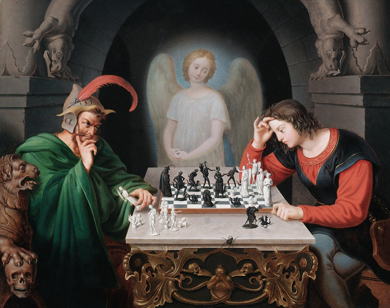

+++
date = '2026-10-12T18:40:36+02:00'
title = 'Over Faust, de duivel en Morphy'
weight = 9223372036640792971
+++

<!--
.image devil.jpg
-->

Toen ik 15 ik jaar was, kreeg ik mijn eerste les Duits. Alsof ieder schooljaar een buis op Frans of Engels (of beiden) niet voldoende was, kwam er nu nog een derde nachtmerrie bij.

Onze leraar was een fervente fan van [Goethe](https://nl.wikipedia.org/wiki/Johann_Wolfgang_von_Goethe) en sleurde te pas en te onpas diens meesterwerk, [Faust](https://nl.wikipedia.org/wiki/Faust_(Goethe)), er bij.

Het verhaal mag er best zijn: de hoofdfiguur, Faust, sluit een pakt met de duivel. Hij ruilt zijn ziel voor Mephisto's geschenken maar vindt het geluk niet.

Nu, vele jaren later, moet ik steeds denken aan dit toneelstuk en vond er warempel een link met het schaakspel bij.

[Moritz Retzsch](https://en.wikipedia.org/wiki/Moritz_Retzsch) is een befaamde Duitse schilder en hij verwoordde het toneelspel in een schilderij en gebruikte het schaakspel als metafoor.

 "Mooi!", zal je zeggen maar het gaat nog veel verder: ook de legendarische [Paul Morphy](https://en.wikipedia.org/wiki/Paul_Morphy) wordt er bijgehaald en het verhaal wil dat Morphy de positie uit het schilderij wint!
 

<!--
.yt bemo-g9gdE4
-->


Je kan de video ook bekijken op [dropbox](https://www.dropbox.com/scl/fi/we17zbiu6quklm4bxj0l2/Who_Really_Beat_the_Devil_at_Chess_The_Story_Beh.mp4?rlkey=yg0vgpmqig864m57my2cqmhvt&dl=0)

