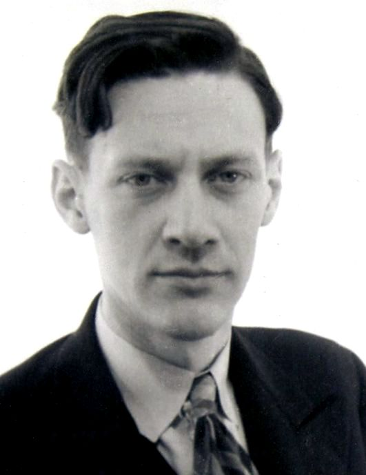

+++
date = '2026-11-13T15:10:41+01:00'
title = 'Adriaan De Groot'
weight = 9223372036638037166
+++

<!--
.image image.jpg
-->

Toen ik in 1975 wiskunde begon te studeren - en schaakgek was - kwam ik er achter dat Adriaan de Groot in mijn eigenste universiteit een ere-doctoraat had gekregen.

**Wie was [Adriaan de Groot](https://nl.wikipedia.org/wiki/Adriaan_de_Groot)**

Deze Nederlander (Santpoort, 26 oktober 1914 - Schiermonnikoog, 14 augustus 2006) was een uiterst veelzijdig man die wetenschappelijk vooral bekend stond als hoogleraar toegepaste psychologie en methodologie. Hij was ook een uitstekend wiskundige en schaker (speelde in het Nederlandsche schaakteam in de Olympiade te Argentinië in 1939).

In 1946 promoveerde De Groot cum laude tot doctor in de Wis- en Natuurkunde op het proefschrift *"Het denken van den schaker"*. Dit werk werd wereldvermaard en niet alleen in schaakkringen. Het werd - op aandringen van Nobelprijswinnaar Herbert Simon - vertaald tot *"Thought and choice in chess"*.

**De kern van het onderzoek**

De Groot liet schakers van uiteenlopend niveau (van clubschakers tot wereldkampioenen zoals [Alexander Aljechin](https://nl.wikipedia.org/wiki/Aleksandr_Aljechin) en [Max Euwe](https://nl.wikipedia.org/wiki/Max_Euwe)) hardop nadenken terwijl ze naar een onbekende schaakstelling keken. Hij analyseerde hun denkprocessen en kwam tot verrassende conclusies:

- Diepte van berekenen: Grootmeesters rekenen niet per se veel dieper of meer zetten vooruit dan sterke amateurs. Beiden bekijken ongeveer evenveel zetten en varianten.

- Patroonherkenning en intuïtie: Het echte verschil zit in de kwaliteit van de eerste ingeving. Grootmeesters herkennen direct de belangrijkste kenmerken van een stelling dankzij jarenlange ervaring en opgeslagen patronen.

- Selectiviteit: Doordat top-schakers meteen de relevante patronen zien, verspillen ze geen tijd aan zwakke zetten. Ze richten hun denkkracht direct op de paar meest kansrijke opties.

**Het geheugenexperiment**

Een beroemd onderdeel van het boek is de geheugentest. De Groot toonde proefpersonen slechts enkele seconden een schaakbord en vroeg hen daarna de stukken na te bouwen:

- Logische spelstellingen: Grootmeesters konden bijna het hele bord foutloos reconstrueren, terwijl amateurs veel fouten maakten.

- Willekeurige opstellingen: Wanneer de stukken willekeurig op het bord stonden zonder schaaklogica, presteerden grootmeesters nauwelijks beter dan beginners.

