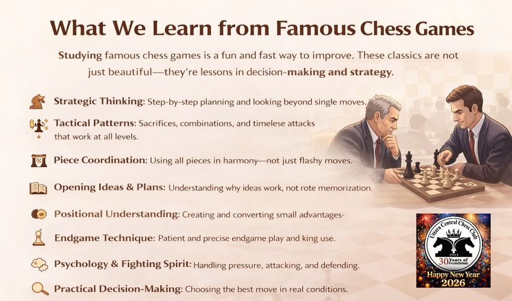

+++
date = '2026-10-30T10:21:57+01:00'
title = 'Hoe selecteer ik partijen ?'
weight = 9223372036639264090
+++

<!--
.image image.jpg
-->

Onlang kreeg ik van Stijn de vraag: "*Hoe selecteer je partijen om les te geven?*" 
Schaakpartijen selecteren met de bedoeling om daar les over te geven is iets anders dan schaakpartijen kiezen die een hoge artistieke waarde hebben.

Het uitgangspunt is natuurlijk het **thema van de les**.

Ik kies partijen via 2 methoden:

Ik volg vrij nauwgezet de live-uitzenden (op YouTube en chess.com) van tornooien. Meestal worden deze van uitmuntende commentaar voorzien door mensen zoals Svidler, Polgar, Leko, Seirawan. Praktisch in elke partij leer ik iets nieuws of wordt bestaande kennis dieper. Het nadeel van deze methode is wel dat het steeds partijen betreft die gaan tussen hedendaagse grootmeesters. ... En deze vind ik - als les - minder interessant: ze zijn gewoon te complex.

Een tweede methode is gebruik te maken van de rijke schaakgeschiedenis en in het bijzonder de partijen die werden gespeeld in de eerste helft van de 20e eeuw. Schaken als wetenschap kwam toen volop in bloei en ja, soms werd er overdreven, maar de beste partijen blijven ongemeen instructief. Ze doorstonden de tand des tijds.
Fijn is ook dat deze partijen werden geselecteerd door anderen vb. in tornooiboeken of door mensen zoals Kasparov.  

