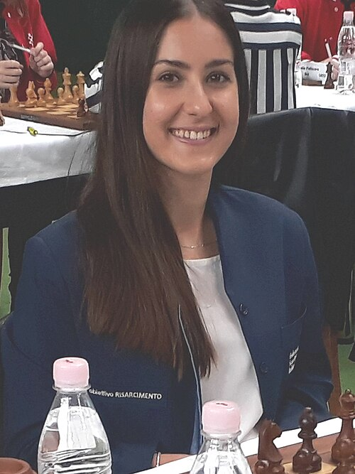

+++
date = '2026-11-17T13:34:38+01:00'
title = 'Spelen tegen uw echtgeno(o)t(e)'
weight = 9223372036637697329
+++

<!--
.image sa.jpg
-->

<!--
.image ns.jpg
-->

[Allesia Santeramo](https://en.wikipedia.org/wiki/Alessia_Santeramo) is een Italiaanse vrouwelijke Fide meester. In 2025 huwde ze de Zwitserse grootmeester 
[Noël Studer](https://en.wikipedia.org/wiki/No%C3%ABl_Studer).

Allesia speelt beduidend zwakker dan haar echtgenoot maar is echt niet te onderschatten.

Kijk maar naar haar partij tegen haar ventje:

<!--
.yt UFDSmTn8Bxc
-->


Je kan de video ook bekijken op [dropbox](https://www.dropbox.com/scl/fi/tmktrarukl1tvf178sg9r/I_Played_My_Grandmaster_Husband_in_a_Real_Tourna.mp4?rlkey=e4l6z2v3st6nravp805o7cbcn&dl=0)

Allesia weet schaakposities uitstekend uit te leggen.

In de volgende video vertelt ze hoe je op een eenvoudige wijze kunt spelen tegen d4-openingen.

<!--
.tube L8N5L3Q7xV0
-->


<!--
.dropbox https://www.dropbox.com/scl/fi/0olyvop5jt5h2wr6yjw1r/How_to_play_against_1_d4_simple_setup_no_memoriz.mp4?rlkey=mw0wuaf6wp0wn5sp5dqxwtylx&st=6o222and&dl=0
-->
Je kan de video ook bekijken op [dropbox](https://www.dropbox.com/scl/fi/0olyvop5jt5h2wr6yjw1r/How_to_play_against_1_d4_simple_setup_no_memoriz.mp4?rlkey=mw0wuaf6wp0wn5sp5dqxwtylx&st=6o222and&dl=0)

