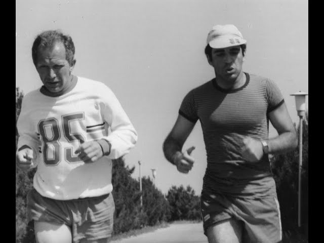

+++
date = '2026-10-30T15:13:56+01:00'
title = 'Hoe trainde Kasparov?'
weight = 9223372036639246571
+++
<!--
.image train.jpg
-->

Kasparov had een unieke manier van trainen: hij speelde om het wereldkampioenschap, stond 5-0 achter tegen Karpov en besloot toen op remise te spelen totdat hij het kon!

<!--
.yt I1nFSbWKrI0
-->


Je kan de video ook bekijken op [dropbox](https://www.dropbox.com/scl/fi/lyk8md6epp68b33aabhtu/How_Kasparov_Really_Trained_I1nFSbWKrI0.mp4?rlkey=h3l9dx21g017d2dx3m6nxj9yz&dl=0)
