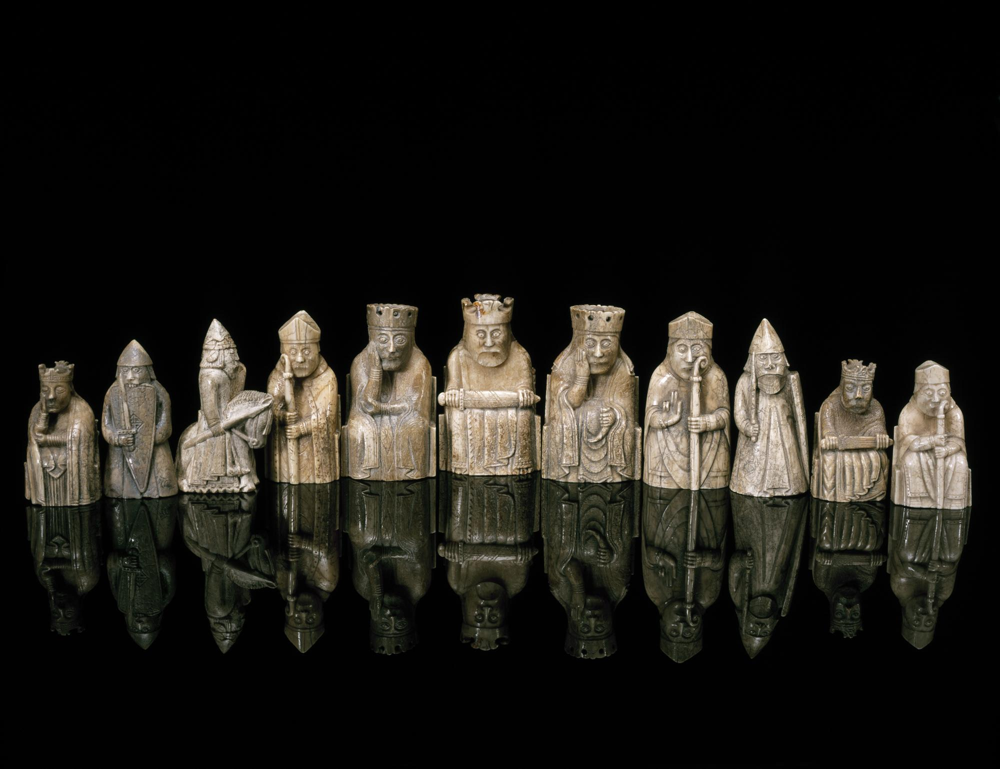

+++
date = '2026-11-10T11:34:39+01:00'
title = 'Lewis-schaakstukken'
weight = 9223372036638309328
+++

<!--
.image lewis.jpg
-->

De [Lewis-schaakstukken](https://nl.wikipedia.org/wiki/Lewis-schaakstukken) zijn 79 schaakstukken van walrusivoor uit de 12e eeuw. Ze zijn vermoedelijk in Noorwegen of IJsland gemaakt en circa 1830 ontdekt op het Schotse eiland Lewis in de Buiten-Hebriden. Het zijn de best bewaard gebleven middeleeuwse schaakstukken en voorbeelden van romaanse ivoorsnijkunst van de allerhoogste kwaliteit. Lewis-schaakstukken zijn tegenwoordig te zien in het British Museum en het National Museum of Scotland.

Ze zijn niet alleen van onschatbare historische waarde, ze zijn ook iets waard in baar geld:

<!--
.yt iGPO2yA0sCM
-->


Je kan de video ook bekijken op [dropbox](https://www.dropbox.com/scl/fi/tjdgz2kp9i2yzjduz87lf/A_5_Chess_Piece_Turned_Out_to_Be_Worth_735_000_i.mp4?rlkey=p8xpq8nza2v9xknogbw9r5mv5&dl=0)

