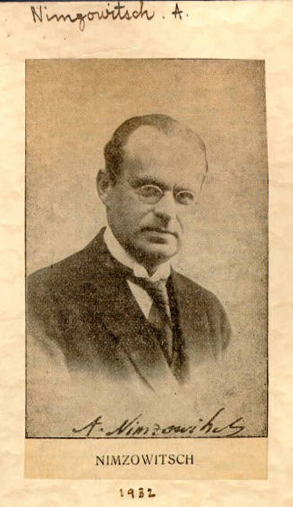
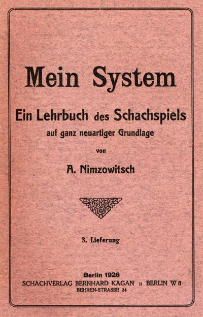
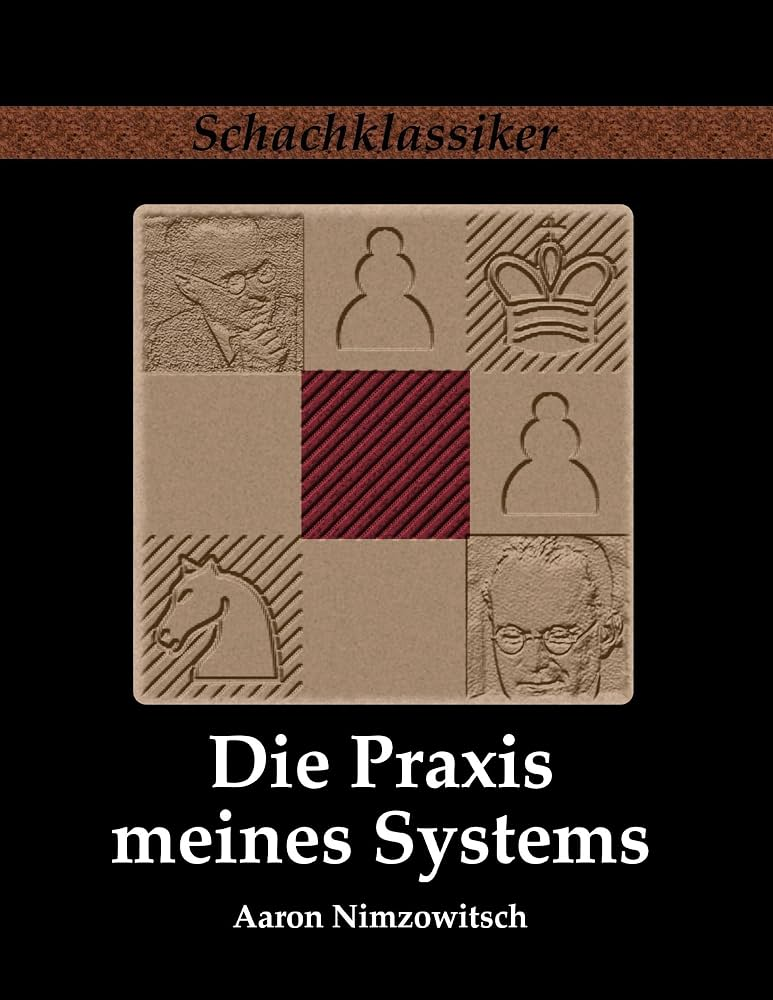

+++
date = '2026-11-03T16:00:28+01:00'
title = 'Aron Nimzowitsch'
weight = 9223372036638898179
+++

<!--
.image nimzo.jpg
-->

[Aron Nimzowitsch](https://nl.wikipedia.org/wiki/Aaron_Nimzowitsch) was een uit Letland afkomstige Deense grootmeester en een van de grondleggers van het hypermodernisme in de schaakwereld. Hij werd wereldwijd bekend door zijn revolutionaire schaakboeken zoals Mijn systeem (Mein System, 1925) en Schachpraxis (1929), waarin hij concepten als profilaxis, blokkade en overbescherming populair maakte. Ook verschillende schaakopeningen, zoals de Nimzo-Indische verdediging,  dragen zijn naam.

Deze specifieke portretfoto dateert van rond 1932 en maakt onder andere deel uit van de collectie van de World Chess Hall of Fame.

**Mein System**

<!--
.image system.jpg
-->

**Schachpraxis**

<!--
.image praxis.jpg
-->

