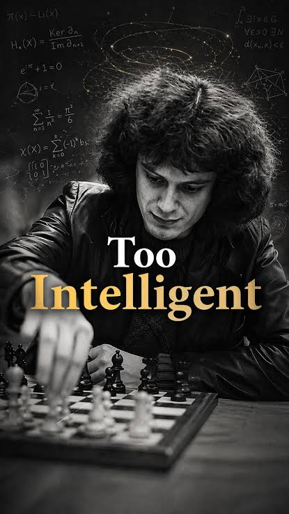
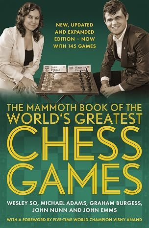

+++
date = '2026-11-03T14:50:30+01:00'
title = 'John Nunn'
weight = 9223372036638902377
+++
<!--
.image nunn.jpg
-->

[John Nunn](https://nl.wikipedia.org/wiki/John_Nunn) is een legende in de schaakwereld: in de vorige eeuw, steevast een top-10 speler. 

Nu een 70-er werd hij al 2x Wereldkampioen bij de senioren.

Magnus Carlsen heeft zo zijn eigen mening over John Nunn:

*"""I am convinced that the reason the Englishman John Nunn never became world champion is that he is too clever for that. ... He has so incredibly much in his head. Simply too much. His enormous powers of understanding and his constant thirst for knowledge distracted him from chess."""*

Hoe het ook zij, als je een schaakboek vindt waarvan John Nunn de auteur is, koop het! Je zal het je niet beklagen.

Zo is hij mede-auteur van het legendarische **The Mammoth Book of the World's Greatest Chess Games**

<!--
.image mammoth.jpg
-->

