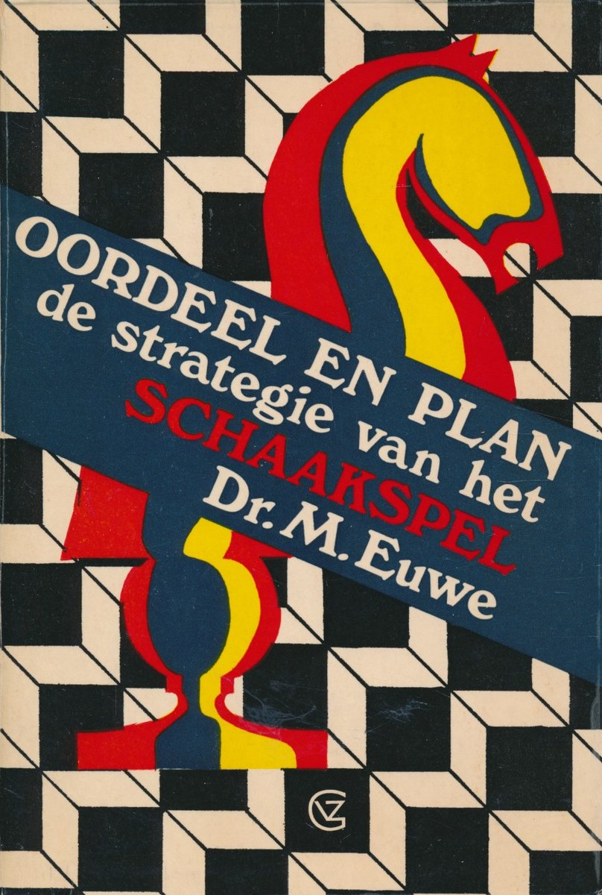

+++
date = '2026-11-12T15:24:53+01:00'
title = 'Oordeel en plan: de strategie van het schaakspel'
weight = 9223372036638122714
+++

<!--
.image image.jpg
-->

*Oordeel en plan: de strategie van het schaakspel* is een klassiek schaakboek van oud-wereldkampioen [Max Euwe](https://nl.wikipedia.org/wiki/Max_Euwe). Het boek vormt de kern van het denkproces in het schaken: hoe je als speler een schaakstelling analyseert en daar een logisch plan aan verbindt.

**De kernmethode van Max Euwe**

Euwe leert schakers om niet zomaar intuïtief of 'op goed geluk' te zetten nadat de openingsfase (meestal na zo'n 8 tot 15 zetten) is afgelopen. Het denkproces verloopt in drie vaste stappen:

*Het Oordeel (De Stelling beoordelen)*

Je analyseert de kenmerken van het bord. Belangrijke elementen hierbij zijn:

- Materiaal: Wie heeft er meer stukken of meer waarde op het bord?
- Koningveiligheid: Staaat de koning veilig, of kan hij worden aangevallen?
- Pionnenstructuur: Zijn er zwakke pionnen, dubbelpionnen, geïsoleerde pionnen of open lijnen?
- Ruimte en activiteit: Welke stukken staan actief (op sterke velden in het centrum) en welke staan passief?

*Het Plan (De strategie bepalen)*

Op basis van je oordeel formuleer je een langetermijndoel. Zoals de bekende schaker [Savielly Tartakower](https://nl.wikipedia.org/wiki/Sawielly_Tartakower) ooit zei: “Strategie is wat je doet als er niets te doen is”.

- Heb je een voordeel in ruimte? Dan bereid je een aanval voor op de vleugel waar de tegenstander zwak is.
- Heb je een betere pionnenstructuur voor het eindspel? Dan probeer je stukken af te ruilen.
- Is de koning van de tegenstander onveilig? Dan plan je een stukkenoffensief naar het koningsgebied.

*De Tactiek (De uitvoering)*

Tactiek is wat je doet wanneer er iets te doen is (vorken, pinnen, matdreigingen, ontdekte schaak). Tactische motieven zijn de concrete middelen of 'gereedschappen' waarmee je de strategische plannen op het bord uitvoert.

**Belangrijke strategische basisprincipes**

Als je een plan opstelt volgens de filosofie van Euwe, houd je rekening met universele vuistregels:

- Centralisatie: Beheers de centrale velden (e4, d4, e5, d5) omdat je stukken daar de grootste bewegingsvrijheid hebben.
- Koningveiligheid: Breng je koning op tijd in de veiligheid via een rokade.
- Profilaxe: Probeer altijd te doorgronden wat de tegenstander van plan is en onderbreek die dreiging vóórdat hij hem uitvoert.
- Harmonie der stukken: Zorg dat je stukken met elkaar samenwerken en elkaar dekken, in plaats van dat één los stuk een aanval probeert te doen.

