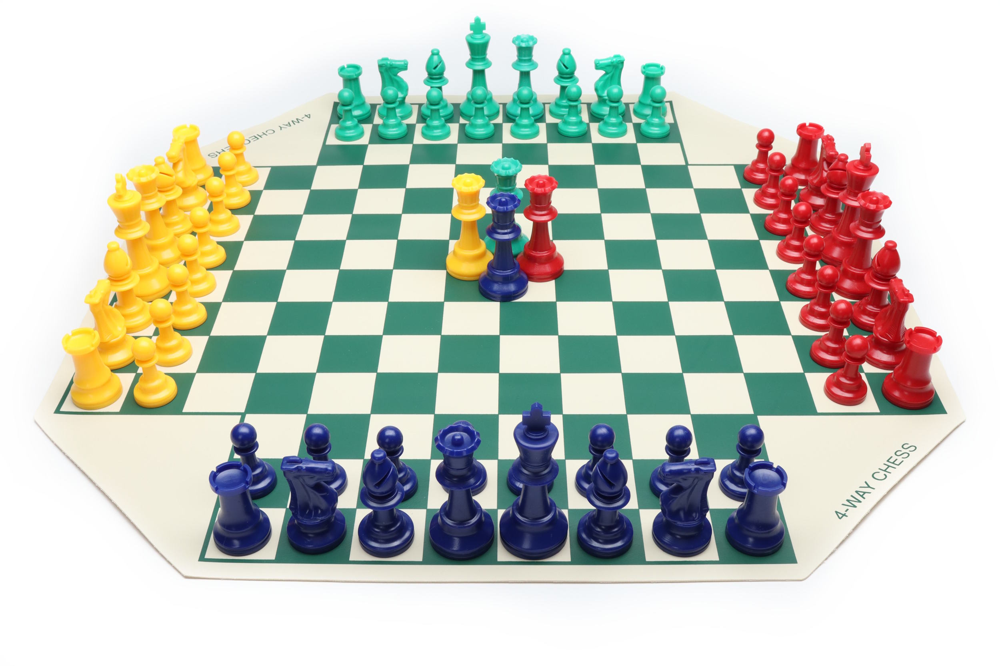
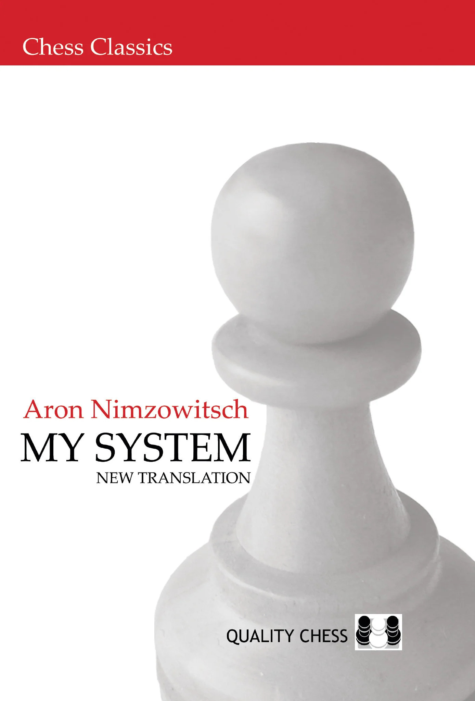
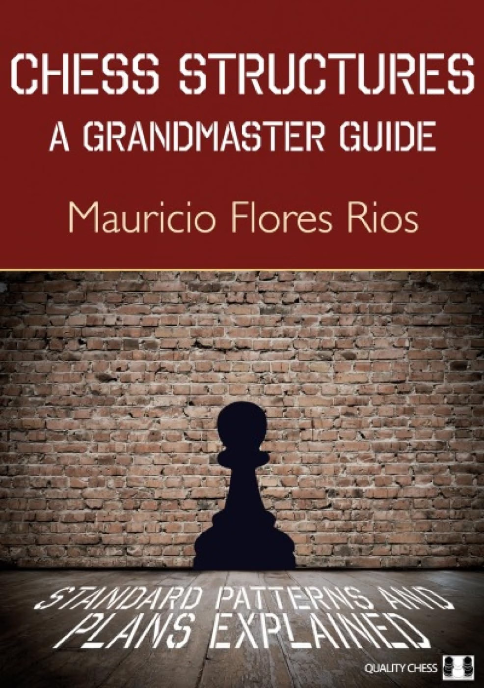
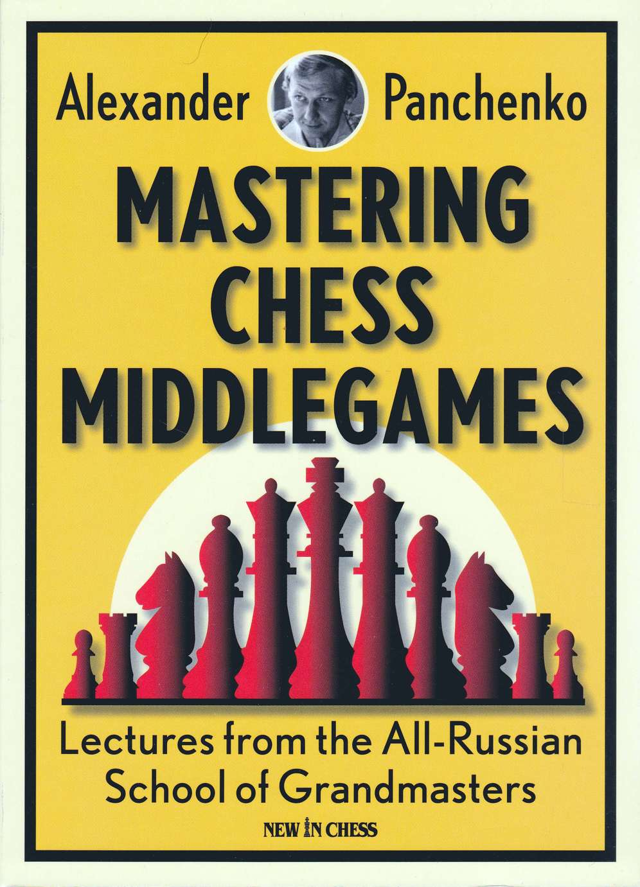

+++
date = '2026-11-26T16:27:04+01:00'
title = 'Boeken over positie-spel'
weight = 9223372036636909383
+++

<!--
.image image.jpg
-->

Een schaakpartij is zelden een "ik kwam, ik zag en ik overwon" affaire. Het is veeleer een voorzichtig manoeuvreren, een cumuleren van kleine voordelen.

Dit is het doel van positioneel schaak. Positioneel schaak heeft 2 componenten: enerzijds is er het herkennen van die kleine voordelen en anderzijds is er de methodiek om daar iets mee te doen.

De volgende boeken behandelen dit onderwerp. Er zijn letterlijk honderden van deze boeken die uitmuntend zijn.

Ikzelf verkies de boeken uit de eerste helft van vorige eeuw: ze zijn niet foutloos maar ze zijn bevattelijk.

<!--
.image system.jpg
-->

Lees zeker [Mein System](https://de.wikipedia.org/wiki/Mein_System) van [Aaron Nimzowitsch](https://nl.wikipedia.org/wiki/Aaron_Nimzowitsch). OK, het is wat over de top maar het is leerrijk en ... fun. Het boek heeft niets voor niets zijn eigen Wikipedia artikel.

<!--
.image rios.jpg
-->

De Chileense grootmeester [Mauricio Flores Ríos](https://en.wikipedia.org/wiki/Mauricio_Flores_R%C3%ADos) schreef "Chess Structures, a grandmaster guide", buitengewoon goed geschreven. Een aanrader, wel voor eerder gevorderde spelers.

<!--
.image pachenko.png
-->
 

Dan wil ik nog het twee-delig werk van [Alexander Panchenko](https://en.wikipedia.org/wiki/Alexander_Panchenko), "Mastering Chess Middlegames
Lectures from the All-Russian School of Grandmasters" naar voor schuiven. Grootmeester Pachenko was een Russisch top-coach. 

