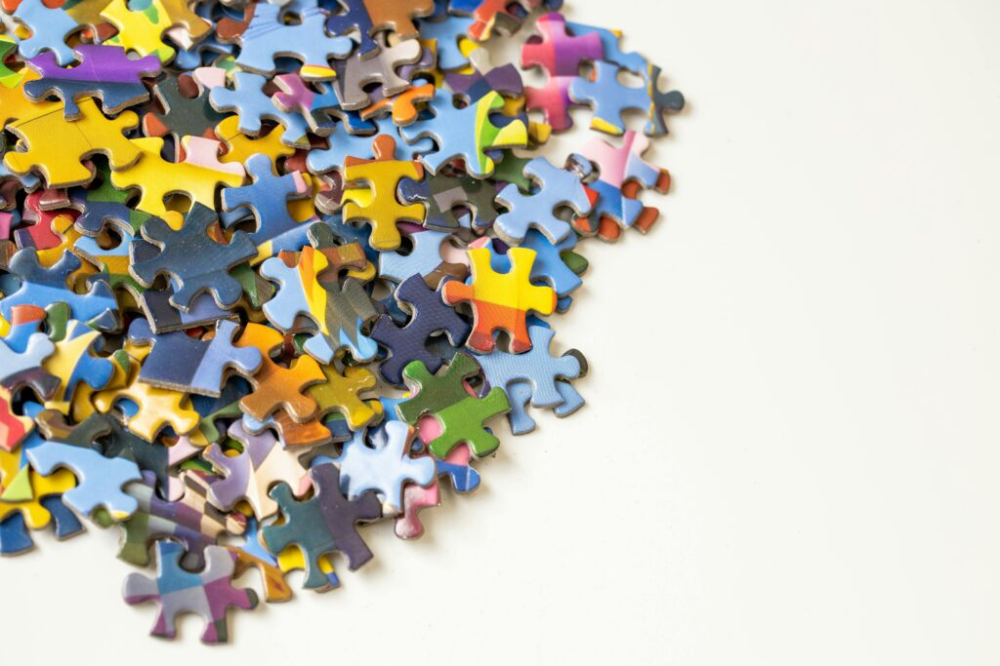

+++
date = '2026-11-13T14:58:32+01:00'
title = 'Oplossen van puzzels'
weight = 9223372036638037895
+++

<!--
.image image.jpg
-->

Word je beter in schaken door schaakpuzzels op te lossen? Volgens gegevens van 24.000 Lichess-spelers lopen de puzzelrating en de speelrating weliswaar gelijk op, maar het verband werkt slechts in één richting. Deze video legt uit waarom het oplossen van puzzels je rating niet op de verwachte manier verhoogt. Hierbij komen onder meer de gezusters Polgár aan bod, de experimenten van De Groot en Chase & Simon naar het vijfsecondengeheugen, en onderzoek naar het aantal uren dat daadwerkelijk nodig is om het meesterniveau te bereiken.

Je ontdekt wat een puzzel wél biedt, maar een echte partij nooit (namelijk: een label of aanwijzing); waarom een ​​schaakmeester weliswaar 50.000 patronen 'ziet', maar desondanks geen willekeurige stelling kan reproduceren; wat de uitkomsten zijn van een Argentijnse studie (waarin 11.053 uur werd geteld); en welke factor bij 375 toernooispelers de beste voorspeller bleek voor hun rating (namelijk: uitsluitend serieuze studie). Ook wordt besproken wat je beter wél kunt doen: werken met stellingen zonder label, die vervolgens volledig worden uitgespeeld en eerlijk worden geanalyseerd. 

<!--
.yt MP_Go5xKKB4
-->


Je kan de video ook bekijken op [dropbox](https://www.dropbox.com/scl/fi/3pgmytpdtt6ohkrz1ic7t/Why_Chess_Puzzles_Don_t_Make_You_Better_MP_Go5xK.mp4?rlkey=sgurjrtqrtvj7zkiyywhis6ef&dl=0)

