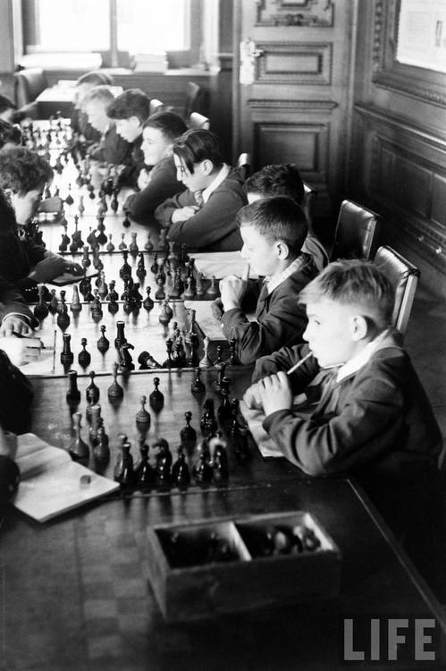

+++
date = '2026-10-23T14:08:55+02:00'
title = 'Soviet chess school'
weight = 9223372036639858872
+++

<!--
.image school.jpg
-->

De [Soviet chess school](https://en.wikipedia.org/wiki/Soviet_chess_school) was legendarisch!

Onder leiding van de *patriarch*  [Mikhail Botvinnik](https://en.wikipedia.org/wiki/Mikhail_Botvinnik) werd een selectie gemaakt van het Sovjet-Russisch schaaktalent.

In de Botwinnik school kregen deze dan de kans om zichzelf te vervolmaken. Stdenten waren o.a. Karpov en Kasparov.

In het volgende filmpje krijg je de doordachte insteek van Peter Svidler.

<!--
.yt 9eTelBNfv4Y
-->


Je kan de video ook bekijken op [dropbox](https://www.dropbox.com/scl/fi/k95d1d189y82zn78zexch/The_Russian_School_of_Chess_How_the_USSR_and_Rus.mp4?rlkey=cw1y7scqot0qezcvkjtic670v&dl=0)

