+++
date = '2026-11-26T14:43:08+01:00'
title = 'Slangenbrein'
weight = 9223372036636915619
+++
<!--
.image snake.jpg
-->
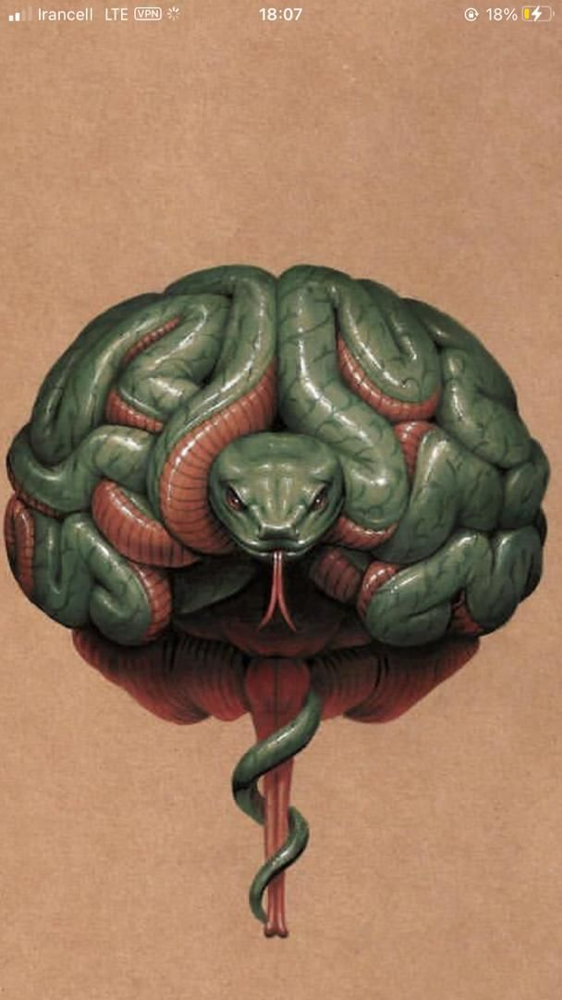

Schakers zijn vindingrijk, genereus in de winst, ridderlijk bij verlies ... en in het bezit van een diep verborgen slangenbrein.

Dit brein komt op het juiste moment in actie en slaat toe, niet gehinderd door enige moraliteit.

De volgende stelling kwam op het bord. Ik speelde met wit, Francis met zwart.

Ik stond reddeloos verloren:

<!--
.diagram fen:3r1nk1/p4p1p/1p6/5N2/8/PBP3PQ/1P3q1P/1K6 b - - 0 1
-->

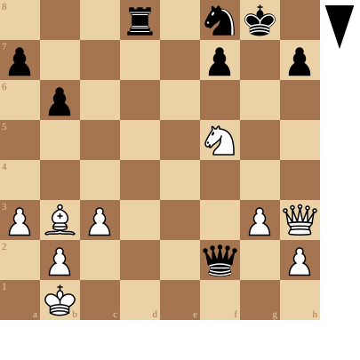

Stockfish schatte me op zo'n 5 punten achterstand.

Ik had echter een paar troeven achter de hand:

- de partij kon maximaal nog 8 minuten duren en dan werd de zaal ontruimd.

- er stonden zeker 5 clubleden te wachten op mijn verlies: winnen was een echte trofee die voor vele bijeenkomsten kon worden gekoesterd. De druk op Francis was enorm.

- mijn slangenbrein overvleugelde alle gevoelens van eerlijkheid en fairplay.

Zwart speelde zondermeer de beste zet:

<!--
.diagram fen:5nk1/p4p1p/1p6/5N2/8/PBP3PQ/1P1r1q1P/1K6 w - - 1 2; redarrow:d8d2
-->

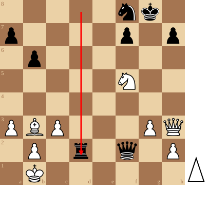

Hier verzonk ik gedurende 6 minuten in een diep denken (er voor zorgend dat er slechts 2 minuten speeltijd overbleef), en speelde een ietwat onverwachte zet: iedereen dacht dat ik nog ging gaan voor een laatste, tot mislukken gedoemde, aanval.

<!--
.diagram fen:5nk1/p4p1p/1p6/8/3N4/PBP3PQ/1P1r1q1P/1K6 b - - 2 2; redarrow:f5d4
-->

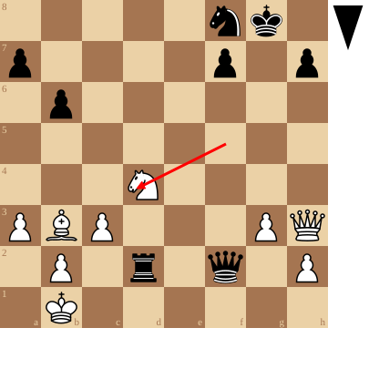

Zwart aarzelde niet en sloeg toe met schaak.

<!--
.diagram fen:5nk1/p4p1p/1p6/8/3N4/PBP3PQ/1r3q1P/1K6 w - - 0 3; redarrow:d2b2
-->

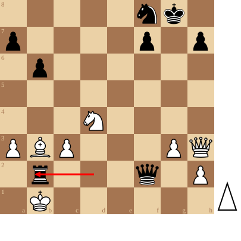

Wit had slechts 1 zet die niet onmiddellijk mat liep.

<!--
.diagram fen:5nk1/p4p1p/1p6/8/3N4/PBP3PQ/1r3q1P/K7 b - - 1 3; redarrow:b1a1
-->

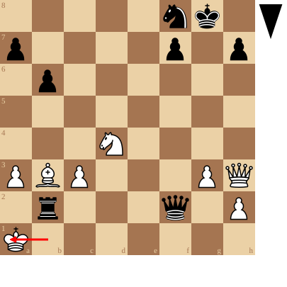

Zwart antwoordde met de 4e Stockfish (ELO 4000) aanbeveling op rij!

<!--
.diagram fen:5nk1/p4p1p/1p6/8/3N4/PBP3PQ/1r1q3P/K7 w - - 2 4; redarrow:f2d2
-->

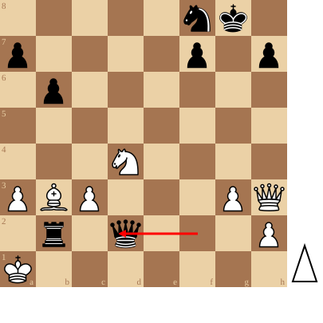

Wit antwoordde met het enige mogelijke antwoord om de mat op de onderste rij te verhinderen.

... de zet uitvoerend, vergezeld met een gebaar van moedeloosheid.

<!--
.image moedeloos.jpg
-->
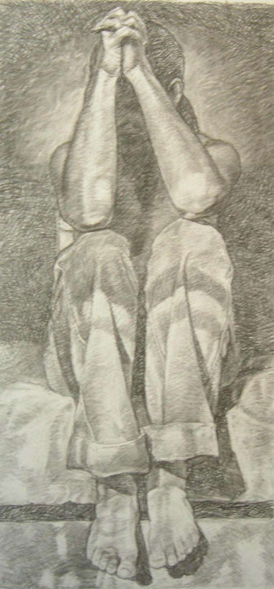

<!--
.diagram fen:5nk1/p4p1p/1p6/8/3N4/PBP3P1/1r1q3P/K4Q2 b - - 3 4; redarrow:h3f1
-->

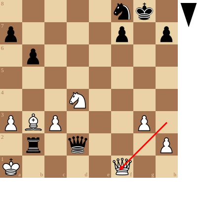

En Zwart "went for the kill":

<!--
.diagram fen:5nk1/p4p1p/1p6/8/3N4/PBq3P1/1r5P/K4Q2 w - - 0 5; redarrow:d2c3
-->

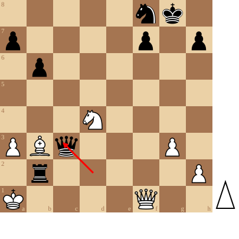

Echter :-)

<!--
.diagram fen:5nk1/p4Q1p/1p6/8/3N4/PBq3P1/1r5P/K7 b - - 0 5; redarrow:f1f7
-->

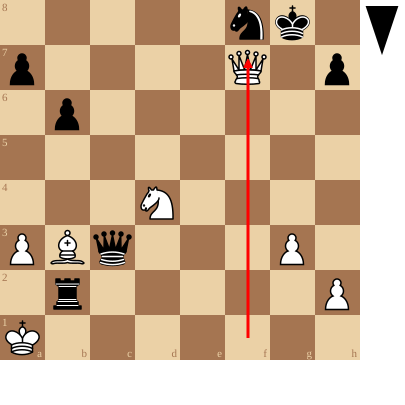

En, net toen de bel ging, Zwart loopt mat op de volgende zet!

Dank u voor uw aandacht!

