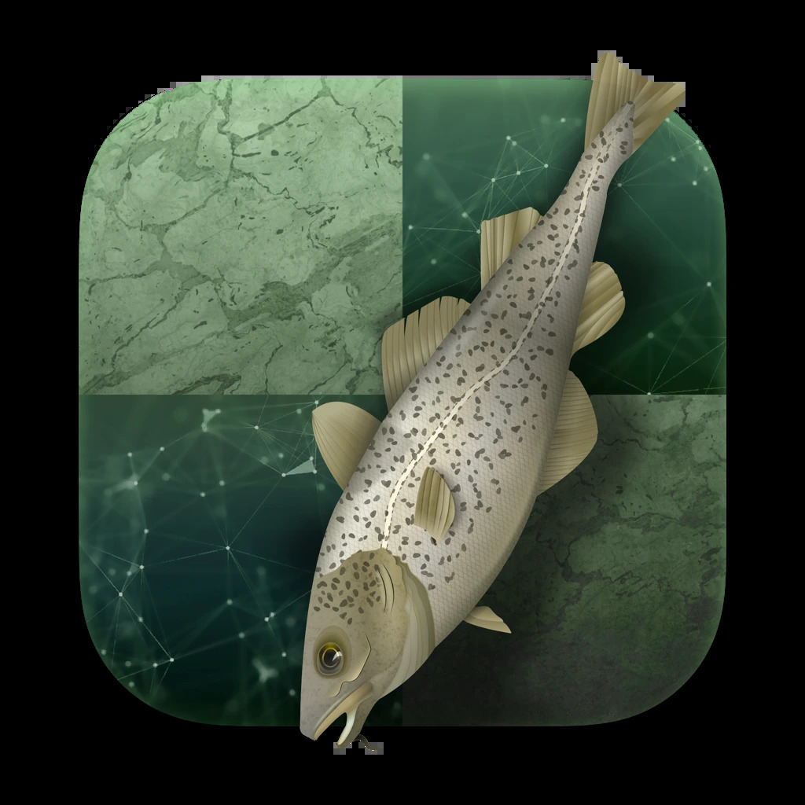

+++
date = '2026-10-18T12:53:27+02:00'
title = 'Stockfish'
weight = 9223372036640295400
+++

<!--
.image stock.jpg
-->

[Stockfish](https://nl.wikipedia.org/wiki/Stockfish) is een gratis en opensource schaakengine, beschikbaar voor verschillende desktop- en mobiele platforms.

Stockfish staat consequent bovenaan in de meeste beoordelingslijsten voor schaakengines en is sinds oktober 2022 de sterkste CPU-schaakengine ter wereld. De geschatte ELO-rating van Stockfish 19 is zo'n 4050.
(Weet dat de hoogste rating van Magnus Carlsen 2882 was - in augustus 2019)
Het heeft het Top Chess Engine Championship 13 keer gewonnen en het Computer Chess Championship van Chess.com 19 keer.

Stockfish is ontwikkeld door Marco Costalba, Joona Kiiski, Gary Linscott, Tord Romstad, Stéphane Nicolet, Stefan Geschwentner en Joost VandeVondele, met veel bijdragen van een community van opensourceontwikkelaars.[3] Het is afgeleid van Glaurung, een opensource-engine van Tord Romstad die in 2004 werd uitgebracht.

De software werkt zowel met brute force als met artificele intelligentie.

De volgende film toont hoe een schaakprogramma wordt ontwikkeld:

<!--
.yt w4FFX_otR-4
-->


Je kan de video ook bekijken op [dropbox](https://www.dropbox.com/scl/fi/by6el5il02vsjgozgbx0n/The_Fascinating_Programming_of_a_Chess_Engine_w4.mp4?rlkey=jhx5ac8cww10kgoq21do44dxy&dl=0)
