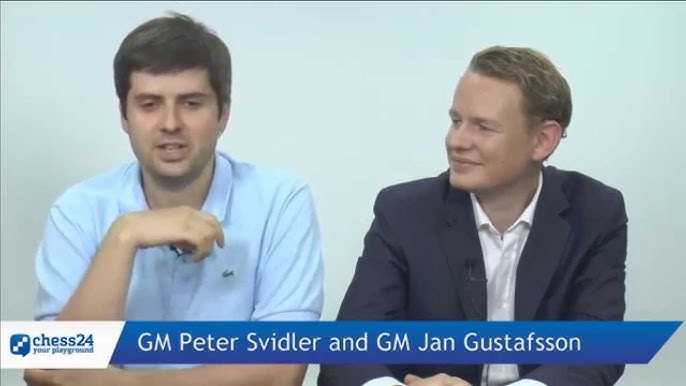

+++
date = '2026-10-18T11:25:43+02:00'
title = 'Peter Svidler'
weight = 9223372036640300664
+++

<!--
.image hq720.jpg
-->

[Pjotr Svidler](https://nl.wikipedia.org/wiki/Pjotr_Svidler) werd 8x kampioen van Rusland, in 1994, 1995, 1997, 2003, 2008, 2011, 2013, 2017
Het is moeilijk te appreciëren wat een prestatie dit is!

Peter Svidler is een erudiet man, een uitstekend commentator: zijn gezamelijke partijbesprekingen met [Jan Gustafsson](https://nl.wikipedia.org/wiki/Jan_Gustafsson) zijn legendarisch.

Zijn duidelijke afkeuring van de Russische invasie van Oekraïne in 2022 maakte hem niet bepaald geliefd in Putin-kringen.

<!--
.yt faJev7VEJm0
-->


Je kan de video ook bekijken op [dropbox](https://www.dropbox.com/scl/fi/ndb5a9s25t332rvdo6wtq/THIS_OR_THAT_things_to_do_with_Chess_Legend_Pete.mp4?rlkey=779f31s2lrh5aoiu8xgkaq0po&dl=0)

