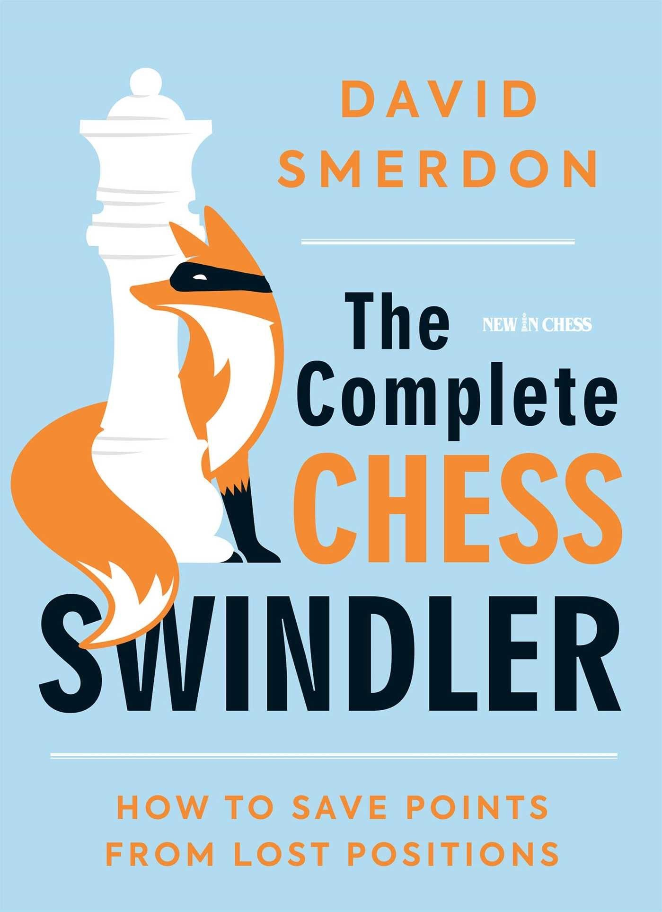
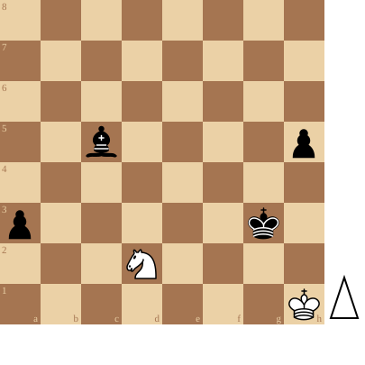
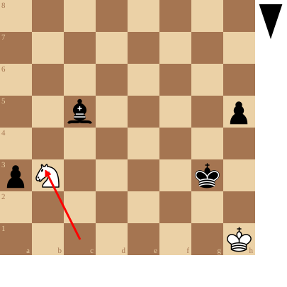
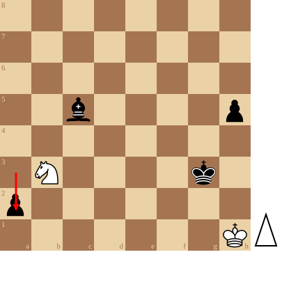
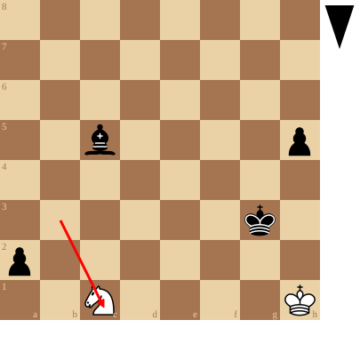
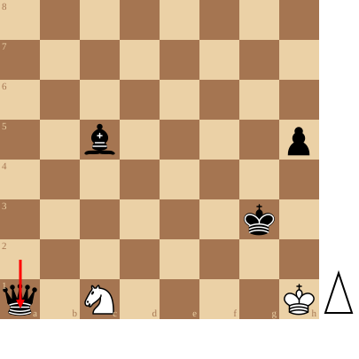
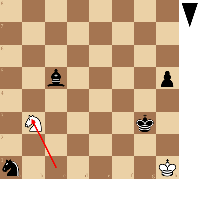

+++
date = '2026-11-26T15:22:20+01:00'
title = 'Schaken en swindelen'
weight = 9223372036636913267
+++

*"""Проходит несколько дней, и вдруг вы невольно начинаете чувствовать, что без шахмат в вашей жизни чего-то не хватает. Что ж, можете порадоваться: вы относитесь к числу тех людей, у которых нет естественного иммунитета к «шахматной болезни»."""*

*"""Er gaan een paar dagen voorbij en plotseling begin je onwillekeurig te merken dat er, zonder schaken, iets in je leven ontbreekt. Dan mag je je verheugen: je behoort tot die groep mensen die geen natuurlijke immuniteit tegen het schaakvirus bezitten."""*

*Michail Tal*

<!--
.image smerdon.jpg
-->

[David Smerdon](https://en.wikipedia.org/wiki/David_Smerdon) is een Australisch grootmeester die als geen andere het slangenbrein begrijpt.
Hij schreef er een gans boek over!  Fijn om te weten dat hij werkt voor de Anglikaanse kerk.

<!--
.image image.jpg
-->

Ik zal u verhalen over de eerste partij uit het boek.

[Semyon Furman](https://en.wikipedia.org/wiki/Semyon_Furman) was een Soviet grootmeester en trainer (Wit-Russische jood). Hij stond radeloos verloren tegen [Jan Smejkal](https://en.wikipedia.org/wiki/Jan_Smejkal), een Tsjechische grootmeester die in de jaren '70 tot de absolute wereldtop behoorde.

<!--
.diagram fen:8/8/8/2b4p/8/p5k1/3N4/7K w - - 0 1
-->

Wit gaf op: de vork op loper en koning levert niets op. De loper gaat weliswaar verloren maar de zwarte koning holt naar de pion op a3 en het paard kan de promotie niet verhinderen.

[Michail Tal](https://nl.wikipedia.org/wiki/Michail_Tal) stond wat verder te kijken naar de stelling en vroeg achteloos aan Smejkal: "... en wat zou je gedaan hebben na Pb3?"

<!--
.diagram fen:8/8/8/2b4p/8/pN4k1/8/7K b - - 1 1; redarrow:c1b3
-->

Smejkal antwoordde: "Ach, a2 natuurlijk"

<!--
.diagram fen:8/8/8/2b4p/8/1N4k1/p7/7K w - - 0 2; redarrow:a3a2
-->

Tal: "Dan speel ik Pc1 en dreig de pion te slaan!"

<!--
.diagram fen:8/8/8/2b4p/8/6k1/p7/2N4K b - - 1 2; redarrow:b3c1
-->

... en promoveer je tot dame dan sta ik pat!

<!--
.diagram fen:8/8/8/2b4p/8/6k1/8/q1N4K w - - 0 3; redarrow:a2a1
-->

Smekjal riposteerde triomfantelijk: "Welnee, ik promoveer tot paard!"

<!--
.diagram fen:8/8/8/2b4p/8/6k1/8/n1N4K w - - 0 3; redarrow:a2a1
-->

"Geen probleem!" zei Tal, "ik speel Pb3"

<!--
.diagram fen:8/8/8/2b4p/8/1N4k1/8/n6K b - - 1 3; redarrow:c1b3
-->

