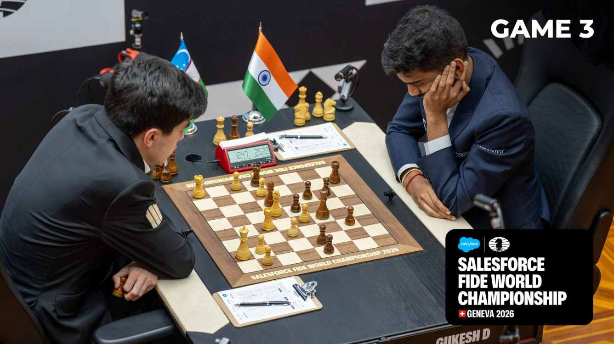
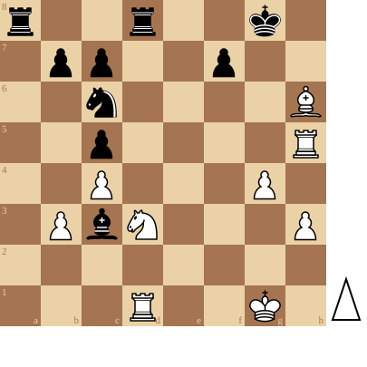
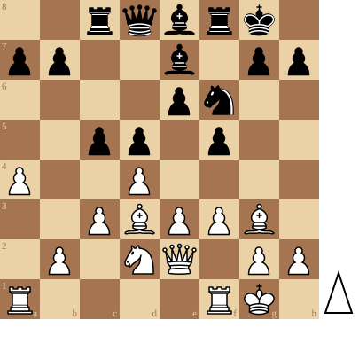
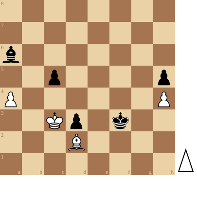

+++
date = '2026-11-27T13:01:37+01:00'
title = 'Wereldkampioenschap 2026: eerste rustdag'
weight = 9223372036636835310
+++

<!--
.image game3.png
-->

(Bespreking overgenomen uit [chess.com](chess.com))

**Partij 1**

<!--
.diagram fen:r2r2k1/1pp2p2/2n4B/2p4R/2P3P1/1PbN3P/8/3R2K1 w - - 13 39
-->

GM Javokhir Sindarov leek in de eerste partij van het Salesforce FIDE Wereldkampioenschap 2026 aan het langste eind te trekken in een gespannen openingsfase, maar wereldkampioen Gukesh Dommaraju wist de druk op het bord en de klok te doorstaan ​​en een remise af te dwingen. Sindarov, die in zijn allereerste wereldkampioenschapspartij met het Berlijns eindspel werd geconfronteerd, kreeg bovendien een tijdstraf van twee minuten omdat hij aan het einde onterecht remise claimde – dit had echter geen gevolgen, aangezien de spelers kort daarna elkaar de hand schudden bij een gelijke stand van 0,5-0,5.

**Partij 2**

<!--
.diagram fen:2rqbrk1/pp2b1pp/4pn2/2pp1p2/P2P4/2PBPPB1/1P1NQ1PP/R4RK1 w - - 9 21
-->

Wereldkampioen Gukesh Dommaraju speelde het Londens Systeem in de tweede partij van het Salesforce FIDE Wereldkampioenschap 2026, maar uitdager GM Javokhir Sindarov was daarop voorbereid. Opnieuw kwam Gukesh achter te staan ​​in tijd, maar net toen Sindarov een gedurfde pionnenopmars inzette en de strijd leek los te barsten, eindigde de partij na 20 zetten in remise door herhaling van zetten. De stand is daarmee weer in evenwicht: 1-1.

**Partij 3**

<!--
.diagram fen:8/8/b7/2p4p/P6P/2Kp1k2/3B4/8 w - - 11 61
-->

Wereldkampioen Gukesh Dommaraju verraste in een vroeg stadium door de Rio de Janeiro-variant van de Berlijnse verdediging te spelen; dit leverde hem een ​​voorsprong van 50 minuten op de klok op. Zijn tegenstander, grootmeester Javokhir Sindarov, bereikte de 40e zet uiteindelijk met nog slechts zes seconden op de klok. De partij was uiterst spannend en zeker niet eenzijdig, aangezien beide spelers kansen kregen om het initiatief naar zich toe te trekken. Uiteindelijk eindigde de derde partij van het Salesforce FIDE Wereldkampioenschap 2026 na 60 zetten in remise. Met een tussenstand van 1,5-1,5 gaan de spelers nu de eerste rustdag in.

