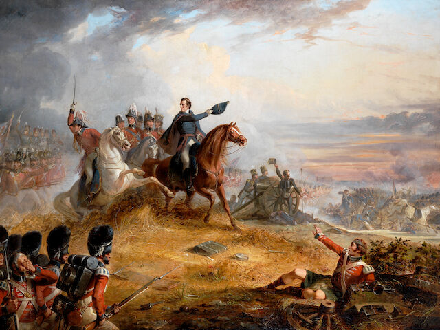

+++
date = '2026-11-10T11:43:06+01:00'
title = 'Een huwelijksgeschenk van Wellington'
weight = 9223372036638308821
+++

<!--
.image image.jpg
-->

[Arthur Wellesley](https://nl.wikipedia.org/wiki/Arthur_Wellesley), later hertog van Wellington, is in de lage landen beter bekend als de ijzeren generaal die Napoleon versloeg te Waterloo.

Dit filmpje vertelt hoe hij een schaakspel cadeau deed bij een huwelijk.

<!--
.yt 7Pl1HO5AUOw
-->


Je kan de video ook bekijken op [dropbox](https://www.dropbox.com/scl/fi/hb71hqzay75r06hx67mvi/Owner_Shocked_By_Value_Of_Gift_From_Duke_Of_Well.mp4?rlkey=85eyp7lgsxuk5mqakeos609em&dl=0)

