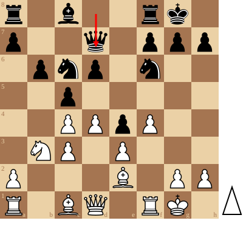

+++
date = '2026-11-03T15:00:30+01:00'
title = 'A Game that Shocked the Chess World. Johner vs Nimzowitsch'
weight = 9223372036638901777
+++

<!--
.diagram fen:r1b2rk1/p2q1ppp/1pnp1n2/2p5/2PPpP2/1NP1P3/P3B1PP/R1BQ1RK1 w - - 2 13; redarrow:d8d7
-->

[Paul Johner](https://en.wikipedia.org/wiki/Paul_Johner) was een Zwitsers schaker en muzikant. Hij won maar liefst 6x het Zwitsers kampioenschap.

In deze partij nam hij het op tegen [Aaron Nimzowitsch](https://nl.wikipedia.org/wiki/Aaron_Nimzowitsch). 

Deze partij werd legendarisch in de schaakgeschiedenis.

<!--
.yt tVf3pdV-Ln4
-->


Je kan de video ook bekijken op [dropbox](https://www.dropbox.com/scl/fi/pp7l2psskzn78dwvv5nyy/A_Game_that_Shocked_the_Chess_World_Johner_vs_Ni.mp4?rlkey=xmyvmx15m5m2vlpgl07owfizz&dl=0)
<!--
.game game.pgn
-->

<!-- Game begin -->
<link href="/okra/js/lichess/pgn/lichess-pgn-viewer.css" type="text/css" rel="stylesheet" />

&#160;

<!-- Game end -->

