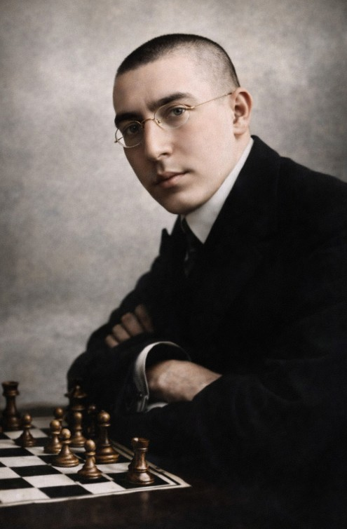

+++
date = '2026-10-27T15:10:55+01:00'
title = 'Erich Cohn versus Akiba Rubinstein'
weight = 9223372036639505952
+++

<!--
.image rubinstein.jpg
-->

[Akiba Kiwelowicz Rubinstein](https://nl.wikipedia.org/wiki/Akiba_Rubinstein) was in de periode 1907-1922 een van de sterkste spelers op het wereldtoneel. In 1907, 1909 en 1911 werd hij kampioen van Rusland.

Rubinstein had echter pech: door de eerste wereldoorlog kon hij nooit spelen voor de wereldtitel. Hij was ook mentaal zwak. 

Door de beide wereldoorlogen heeft het schaken hem financieel niet veel opgebracht. Hij kwam niet graag onder de mensen, werd op den duur mensenschuw en eindigde zijn leven in 1961 in een sanatorium in België waarvoor hij de kosten niet zelf kon opbrengen: er werd een fonds voor hem opgericht. België was ook het land waar hij tijdens de Tweede Wereldoorlog verbleef.

De volgende tekst, overgenomen uit [chess.com](https://www.chess.com/blog/kahns/a-century-of-chess-akiba-rubinstein-1900-1909-2), vertelt meer over de man:

"""
**A Century of Chess: Akiba Rubinstein (1900-1909)**

The Rubinstein story I first came across is that Rubinstein appeared in a chess club and made no initial impression - was one of the weakest players there, lost to the top players at knight or rook odds. Then he disappeared, studied assiduously, rematerialized several months later, went straight up to the club's top player who "smiled indulgently" at the challenge. Rubinstein, of course, thrashed him - and never looked back. In some versions of the story that opponent is Bartoszkiewicz and in some it’s Salwe and the setting shifts between Bialystok and Lodz. It’s also not clear if, in its essentials, the story is really true - was Rubinstein really so untalented? Did his chess skill really come entirely from relentless solitary study?

What’s frustrating about him is that the key stories always seem to be just beyond the threshold of anecdote - they’re not properly documented and so it becomes very difficult to get a sense of what his actual personality really was. What is clear is that he obviously made a very strong impression on the chess world of the 1900s. He was from a different mindset than the cosmopolitan masters - he was poor, religious, and absolutely fanatical about chess. As late as 1939, an English-language biography of Rubinstein opened, "Deep out of the shadows of the Middle Ages came Akiva Rubinstein. A dark squalid ghetto of Russia-Poland was the ghetto in which his spark of life was kindled." This wasn’t, as I read it, anti-Semitism - a plurality of chess masters in the classical era were Jewish (as was, I'm guessing, Barnie Winkelman, who wrote the piece) - but it was reflective of a very strong streak of Jewish snobbery, the feeling that Rubinstein was a shtetlnik or a nyekulturni, which was the slur that the Soviet masters used for the teenage Bobby Fischer, a sense that Rubinstein just wasn’t of their class. Closely allied with the equivocal reaction to Rubinstein’s social origins was a fascination and repulsion with his evident total obsession with chess. Among the elite, chess was still considered to be a pastime - the idea was to excel at it but for chess to remain a hobby, not too much of a distraction from one’s medical practice or mathematics Ph.D. Rubinstein was one of the first people - Chigorin may have a claim to this honor as well - who very clearly thought about nothing but chess. And there is the sense that everybody kind of knew that this was the wave of the future - that a new type of chess master was coming who was not stylish or a gentleman, who was technically-minded and hard-working and would put the game on a completely logical footing and, in so doing, would take away a certain amount of the charm and the fun. Rubinstein was really the archetype of this - it’s echoed in the dwarf of Canetti’s Auto-da-Fé, in Nabokov’s Luzhin and the unreal men H.G. Wells encountered in the chess clubs, in the enduring figure of the chess nerd. And, for the hardcore, there is a certain pride in this archetype. The other stars of the classical people come across like dilettantes - while Rubinstein was the first to treat the game with the boundless respect that it deserves.

In terms of tournament results, Rubinstein was known in the Polish scene by 1902, played at Kiev 1903, broke into the European circuit with a shared first at the Barmen 1905 Hauptturnier, really made his mark by reaching the winners’ circle at the mammoth Ostend 1906 tournament, then became the coming man with wins at Ostend-B and Karlsbad in 1907.

And here there’s another vital, revealing story about Rubinstein which may or may not be true - that Rubinstein toyed with the estimable Heinrich Wolf during the last round game of Karlsbad 1907, declining an early draw offer that would have given him first prize, building up an overpowering position and then letting Wolf wriggle off the hook with the explanation, "Against Wolf I draw when I want to." That imperiousness of Rubinstein’s really makes him seem like his era’s answer to Bobby Fischer - and is very much at odds with most remembrances of him, that he was so self-effacing, at least later in his career, that he retreated to the far corner of the playing hall during his opponents' thinking time so as not to distract an opponent with the loathsome sight of himself. So it’s possible that both stories are true - that Rubinstein had an aggrandizing streak as a young man which disappeared as he sank into depression and mental health problems - but it’s also conceivable that Rubinstein never said that line about Wolf and was painfully shy right from the beginning.

**The sweet shy Rubinstein**
Hard to know. In any case, the first chinks in the armor started to appear in 1908-09: less-than-overpowering performances in the premier tournaments of 1908, a near-disaster in a match against Jacques Mieses, an occasional habit of blundering inexplicably. (Richard Réti, in his Masters of the Chessboard, claimed that it was the blundering propensity, the result either of nerves or of his late start in the game, that kept Rubinstein from becoming world champion.) But 1909 also featured one of the crowning achievements - shared first with Lasker at St. Petersburg 1909, a full 3.5 points ahead of the rest of the field, and an indication that Rubinstein and Lasker (with Capablanca soon to join them) were just on a different level from everybody else. And that was where Rubinstein ended the decade, the master’s master, pretty clearly the greatest positional and endgame player who had ever lived, possessing a degree of precision and intensity that most chess players didn’t know was possible - and fully deserving of a world championship match but also with no fundraising capacity or practical wherewithal and, almost from the beginning, with very little chance of seeing a match come to fruition.

**The imperious Rubinstein**
Rubinstein's Style

*1. Architecture*

"Rubinstein is the greatest artist among the chess players," wrote Richard Réti. "His games create the impression of a great structure from which one stone dare not be shifted." That’s the overriding - and very beautiful - impression of Rubinstein’s play. The position was sacrosanct for him and was developed with exquisite care and craftsmanship. In Rubinstein’s games, there is almost no sense of taking the fight to the opponent - and, for such a great player, virtually no sense of dynamics. Everything feels two-dimensional, very much like creating a work of art, and there’s an evident belief in his play - very appealing for connoisseurs - that the position is a goal in itself and that the winning part of chess is really secondary to the craft.

*2. Foreshortening*

The word medieval keeps coming up with Rubinstein. It’s in Winkelman's line, echoed by Gerald Abrahams, about Rubinstein’s having emerged from the non-modernized Jewish Orthodox community, it's in Spielmann's sudden exclamation after a loss that if Rubinstein had lived in the Middle Ages he would have been burnt at the stake for his wizardry in rook-and-pawn endgames, it’s in Rubinstein’s preference for the rook, for painstaking maneuvers, as if he were offended by the ‘powerful queen’ and the ‘speed-the-game-up’ rules that were developed in the Renaissance and spoiled some underlying integrity, and it’s in a certain aesthetic in his games, which I associate with the foreshortening of Mantegna or Porto della Francesca, an efficient if slightly crude method of reaching the kind of totalizing effect he was after. 

The kind of static aesthetic that - somewhat randomly - I associate with Rubinstein
Emphasis is on exchanges, on short-circuiting the middlegame as much as possible, and reaching a favorable, or simply an equal endgame, in which Rubinstein would then promptly outplay his opponent. To admirers, the sense is that Rubinstein had more or less solved chess - winning games along strictly logical lines and taking virtually no risks whatsoever. To critics, though, it could feel as if he were just an endgame specialist and nervous about all the tactical possibilities of a wild middlegame - and was taking advantage of the somewhat weak technique and natural impatience of his opponents, who accepted exchanges that they should have avoided and were willing to play into Rubinstein’s hands.

*3. Rook endgames*

This is what Rubinstein is best known for, and skilled chess players tend to be almost speechless with admiration for Rubinstein’s ability in this phase of the game. Tartakower's line “Rubinstein is the rook endgame of a game that was started by God a thousand years ago" is the boldest statement that’s been made about Rubinstein’s prowess here but it’s in line with the consensus of the chess community. I remember the kind of dispiriting moment when I was becoming a tournament player and realized how many games reached their logical conclusion in rook endgames - which I found tedious and technical (and realized that, by the same token, chess was maybe at heart a tedious and technical game). Rubinstein seems to have come to the same realization but fully embraced it - I have the sense that those legendary months when he did nothing but study before challenging Bartoszkiewicz were given over almost entirely to analyzing rook endgames. And the sensation of playing over his games is of getting to something like the periodic table of chess, Rubinstein having a sense for the ‘true endgame’ that existed like chemical building-blocks beneath every apparently-complex middlegame, and then, at the earliest possible opportunity, simplifying to get there and winning through microscopic attention to detail.

It wasn’t just rook endgames - Rubinstein’s king-and-pawn endgame against Cohn is probably the most famous king-and-pawn endgame ever played, and his ability to convert endgames when an exchange ahead became the textbook model for generations - but rook endgames were the specialty and, in playing these over, there’s the sense that Rubinstein had accessed some sub-atomic level of chess and was playing with a completely unprecedented degree of precision while everybody else was mucking around on the surface.

**Rubinstein in the Opening**

Rubinstein’s approach to the opening, like the middlegame, seemed to be to get through it as fast as possible and to reach his beloved endgames. But he was a specialist in a few lines, all of which served to neutralize an opponent’s dynamic ideas and to turn the game towards the rational positions and static structures he favored. No less an authority than Boris Gelfand claims, a bit dramatically, that "Most of the modern openings are based on Rubinstein." The Rubinstein French is probably his most enduring legacy - an apparently inoffensive line that brought black close to equality by move 3. He had an even greater impact in classical chess through his advocacy of the Queen Pawn’s Game, the 5.Bf4 and 7.Qc2 lines from the white side of the Queen’s Gambit, all of which created slightly greater fluidity and room to maneuver than in the hackneyed opening lines of the era and took the play into a more purely positional direction. In the greater chess world - at the level of clubs more so than the true elite - Rubinstein was the high priest of 1.d4. The Budapest Gambit, for instance, was developed specifically to trip him up - out of a sense that standard lines gave white an enduring advantage in the Queen’s Pawn Opening. When Irving Chernev wrote, "At some time in his life, almost every chessplayer makes a happy discovery - the Queen's Pawn Opening," he clearly had Rubinstein in mind - the sense that Rubinstein showed that 1.d4 gave white virtually a permanent positional advantage, heading off black’s counterplay even before it began and giving white just the kind of queenside spatial advantage that, with precise, high-level play he could convert to a favorable endgame.

Sources: There's been a great deal written on Rubinstein, although the gaps in biographical knowledge of him remain a bit infuriating. I'm treating Donaldson and Minev's The Life and Games of Akiva Rubinstein: Uncrowned King as authoritative - although, unfortunately, they haven't been able to answer many of the outstanding questions, which seem to be lost in the mists of time (when did Rubinstein start playing; how exactly did he get to be so good; what is the truth of the Bartkoszkiewicz and Wolf anecdotes). Richard Réti writes very well about Rubinstein both in his Masters of the Chessboard and in Modern Ideas In Chess. Zenon Franco's Rubinstein: Move by Move offers a nice analysis of his style and Rubinstein's Chess Masterpieces is the classic book on him. 
Plugs: As usual, I'll plug for my non-chess-writing - Castalia on the Substack platform. Work this week includes - appropriately for Rubinstein - an article on the nebbish archetype from Yiddish folklore to the present-day, Russian nationalists, incels, open marriages, Ocean Vuong and Jill Lepore, and the short story 'Day After.' 

"""

In de volgende partij speelt Rubinstein tegen [Erich Cohn](https://en.wikipedia.org/wiki/Erich_Cohn). Cohn was een sterke speler maar niet van het niveau van Rubinstein. 

<!--
.yt UTLcnJaMwrA
-->


Je kan de video ook bekijken op [dropbox](https://www.dropbox.com/scl/fi/am5ac8f7db9r2k1ho3890/Ultimate_Example_Passive_vs_Active_Defense_Erich.mp4?rlkey=d5buibucoebh3fil5diz3rf8k&dl=0)
<!--
.game game.pgn
-->

<!-- Game begin -->
<link href="/okra/js/lichess/pgn/lichess-pgn-viewer.css" type="text/css" rel="stylesheet" />

&#160;

<!-- Game end -->

