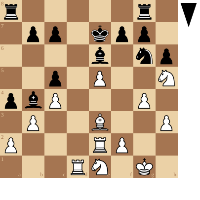

+++
date = '2026-11-25T11:11:31+01:00'
title = 'Wereldkampioenschap 2026: partij 1'
weight = 9223372036637014716
+++

Meestal zijn de eerste partijen van een wereldkampioenschap wat aftasten.

Ondanks het gelijkspel was er toch reeds heel wat te beleven.

In deze video kan je zien hoe Gukesh - in tijdnood - een duivels valsstrik wist te vermijden

<!--
.yt jskShD3JUi4
-->


Je kan de video ook bekijken op [dropbox](https://www.dropbox.com/scl/fi/kyq19qmyrxncd2c1oo1wk/Stockfish_19_Reveals_the_Hidden_Traps_Behind_Sin.mp4?rlkey=kmyrnmsar18znv9119yukebph&dl=0)

<!--
.diagram fen:r5r1/1pp1kpp1/4b1np/2p1P2N/pbP3P1/1P2B2P/P3RP2/3RN1K1 b - - 0 1
-->

Het lijkt wel of Zwart een pion kan winnen.

Deze partij werd overgenomen uit [chess.com](https://chess.com)

<!--
.game game.pgn
-->

<!-- Game begin -->
<link href="/okra/js/lichess/pgn/lichess-pgn-viewer.css" type="text/css" rel="stylesheet" />

<div id="game" data-pgn="[Event &#34;Salesforce FIDE World Championship 2026&#34;]&#10;[Site &#34;Geneva, Switzerland&#34;]&#10;[Date &#34;2026.11.24&#34;]&#10;[Round &#34;1&#34;]&#10;[White &#34;Sindarov, Javokhir&#34;]&#10;[Black &#34;Gukesh D&#34;]&#10;[Result &#34;1/2-1/2&#34;]&#10;[Annotator &#34;Bojkov,Dejan&#34;]&#10;[ECO &#34;C67&#34;]&#10;[WhiteElo &#34;2782&#34;]&#10;[BlackElo &#34;2710&#34;]&#10;[PlyCount &#34;73&#34;]&#10;[EventDate &#34;2026.??.??&#34;]&#10;[Link &#34;https://www.chess.com/news/view/2026-fide-world-chess-championship-game-1&#34;]&#10;&#10;1. e4 e5 2. Nf3 Nc6 3. Bb5 Nf6 {The solid Berlin Defense. This was the line that&#10;practically put an end to the Kasparov era. It is also indicative of the world&#10;champion&#39;s strategy. Solid, proven lines, with no objection to an endgame as&#10;Black.} 4. O-O Nxe4 5. d4 Nd6 6. Bxc6 {Curiously, in his first world&#10;championship match game Sindarov chooses to play an endgame. He had never used&#10;this line before, but at the press conference explained his choice: \&#34;Normally,&#10;in the first game, you try to play more solid; you adapt to the tournament hall,&#10;everything. So I&#39;m trying to join the tournament and not trying to push too&#10;much, to keep control of the game.\&#34;} ({Here is more typical play by the Uzbek&#10;GM from a year ago:} 6. Ba4 e4 7. Ne5 Be7 8. Re1 O-O 9. Nc3 Nf5 10. Rxe4 Nxe5&#10;11. dxe5 c6 12. Bf4 d5 13. exd6 Bxd6 14. Bb3 {1-0 Sindarov,J&#10;(2721)-Maghsoodloo,P (2697) Comet op Titled Losers Chess.com INT blitz 2025&#10;(4.4)}) 6... dxc6 7. dxe5 Nf5 8. Qxd8+ Kxd8 9. Rd1+ ({Gukesh has only faced} 9.&#10;h3 {and this was a blitz game that went} 9... a5 10. Nc3 Ke8 11. Bf4 a4 12. Rad1&#10;h6 13. a3 Ne7 14. Nd4 Nf5 15. Nf3 Be6 {1/2 Shankland,S (2621)-Gukesh,D (2687)&#10;Saint Louis Blitz 2025 (11)}) 9... Ke8 10. Nc3 Ne7 11. h3 Ng6 12. Be3 (12. b3&#10;{is more common in this position and Gukesh had already tried it, but as White,&#10;in the following highly-entertaining game that ended in a draw:} 12... Be7 13.&#10;Bb2 h5 14. Re1 h4 15. Ne4 Kf8 16. Rad1 Rb8 17. Nf6 Nf4 18. Nd7+ Bxd7 19. Rxd7&#10;Ke8 20. Rdd1 c5 21. Nd2 Kd7 22. Nc4+ Ke6 23. Rd6+ cxd6 24. exd6+ Kd5 25. Re5+&#10;Kc6 26. Rxe7 f6 27. Rxg7 {1/2 Gukesh,D (2766)-Firouzja,A (2751) Sinquefield Cup&#10;11th Saint Louis 2024 (4)}) 12... Be7 {Simply completing development.} ({Black&#10;has also tried the preliminary} 12... Bb4 13. Ne2 Be7 {, with the idea of&#10;...c6-c5 (so that White can&#39;t immediately move his knight to d5) (Krasenkow). On&#10;the other hand, as we shall see in the game, the white knight is eager to get to&#10;the h5-square.} ({A more recent game saw Black holding his own after} 13... h6&#10;14. Ng3 h5 15. Bg5 Be7 16. Bxe7 Kxe7 $12 {1/2 Grandelius $146 (2684)-Antipov,M (2606)&#10;FIDE World Cup Baku 2023 (2.2)}) 14. c4 Be6 15. Rac1 c5 16. b3 b6 17. Nc3 h6&#10;{1/2 (24) Dervishi,E (2478)-Miles,A (2584) Saint Vincent 2000}) 13. Ne4 $5&#10;{Sindarov blitzed out this move and his opponent plunged into deep thought.}&#10;({Caruana&#39;s treatment of the position was the straightforward} 13. Rd2 h5 14.&#10;Re1 h4 15. Ne4 Bf5 16. Bg5 {White was successful after} 16... Bxg5 $6 ({However,&#10;GM Krasenkow proved that Black is OK after} 16... Rd8 $1 {The logical continuation&#10;of Black&#39;s plan when} 17. Nd6+ cxd6 18. exd6 {is not dangerous due to} 18... f6&#10;19. dxe7 Rxd2 20. Bxd2 Kf7 21. Bb4 b6 22. Bd6 c5 23. c3 Be6 24. b4 {(otherwise&#10;Black regains the e7-pawn and equalizes.)} 24... Nxe7 25. bxc5 Nc8 {, and White&#10;can&#39;t keep his material gains.}) 17. Nexg5 {1-0 Caruana,F (2835)-So,W (2770)&#10;Clutch-ch May Lichess.org INT rapid 2020 (2.2) With an edge for White.}) 13...&#10;Bd7 $146 {Another solid move, and a novelty.} ({From a practical standpoint it is&#10;not worth risking entering the opponent&#39;s prep after the principled} 13... Bf5&#10;14. Ng3 Bxc2 15. Rd2 Ba4 {The black bishop is out of play, whereas the white&#10;knight establishes itself on a brilliant square with} 16. Nf5 ({Also interesting&#10;is the preliminary} 16. b3 Bb5 17. Nd4 $5 ({Or even} 17. Rad1)) 16... Rg8&#10;{White&#39;s compensation is obvious and he may even try more forcing moves like}&#10;17. e6 $5 fxe6 18. Nxe7 Nxe7 (18... Kxe7 19. Re1 $1 {This is already very&#10;unpleasant for the second player.}) 19. Ng5 ({Or again} 19. b3 $5 Bb5 20. Nd4)&#10;19... Rd8 20. Re1 {Black still has to prove equilibrium.}) ({The predecessor was&#10;a rather short email game:} 13... h5 14. Rd2 h4 15. Rad1 Bf5 {1/2 Richter,W&#10;(2418)-Cvak,R (2351) Remote Superturnier 28 email Remote email 2017}) 14. c4&#10;{Another practical decision by the contender, who believed that this should be&#10;played sooner or later.} (14. Rd2 $5 {\&#34;Practically better to play—you keep&#10;hiding your ideas.\&#34; (Sindarov) To this, Gukesh would most likely have continued&#10;as in the game with} 14... a5 ({But} 14... Rd8 {seems OK for Black too.}) 15.&#10;Ng3 a4 16. Rad1 Be6) 14... a5 15. Rd2 a4 {Gukesh is making the most out of the&#10;a-file, but the engine is slightly critical of this choice.} (15... Rd8 {now&#10;seems illogical as the a5-pawn might be targeted later, say after} 16. Rad1 Bc8&#10;17. Rxd8+ Bxd8 18. Bd2 a4 19. b3 axb3 20. axb3 {White is about to gain the&#10;a-file, but nothing really decisive has happened yet. Black may continue with}&#10;20... f6 {and should be close to equality.}) 16. Rad1 Be6 17. b3 Bb4 $1 {An&#10;important move according to the world champion. The rook is smoked out of the&#10;d-file. However, it cost Black a whopping 40 minutes on his clock.} ({Black&#10;cannot fight the rooks with} 17... Rd8 $2 18. Rxd8+ Bxd8 19. Nc5) 18. Re2 {White&#10;in turn is X-raying the black king.} ({While thinking about the move in the&#10;game, White thought that the best might be the cunning} 18. Rb2 $1 {(Sindarov) in&#10;order to provoke the bishop to} 18... Ba3 {And only then} ({Another point behind&#10;White&#39;s idea is the strong pressure that the rook suddenly exerts along the&#10;b-file, as in the line} 18... axb3 19. Rxb3 $1 Ba5 20. Nd4 $3 {A very powerful&#10;idea.} (20. Rxb7 Bxc4 {is not as effective.}) 20... Bxc4 21. Nf5 $1 {And suddenly&#10;the black king is in mortal danger, one pretty line being} 21... Bxb3 22. Nxg7+&#10;Kf8 23. Nf5 $3 Bxd1 24. Nf6 $1 h6 25. Bc5+ Ne7 26. Bxe7#) 19. Re2 $1 {The black&#10;dark-squared bishop is definitely not as good as in the game now.}) 18... h6 $1&#10;{Another key defensive move that Gukesh was proud of.} ({Black should definitely&#10;not allow the white knights close to his residence with} 18... Bf5 $2 19. Ng3 Be6&#10;20. Nh5 Rg8 21. Ng5) ({As for the immediate} 18... Ke7 $2 {it is just awkward for&#10;Black due to the simple} 19. Bg5+ ({Or the super-sophisticated} 19. a3 $3 Bxa3&#10;20. Ra2 axb3 ({White has a decisive attack in case of} 20... Bb4 21. Bg5+ f6 22.&#10;exf6+) 21. Rxa3 $1 {The tactical point $1} 21... Rxa3 22. Bc5+ $16 {with a large edge&#10;for White.})) 19. Ng3 c5 {Taking the d4-spot under control.} ({The engine&#10;believes that it is more precise to defend with} 19... h5 $5 20. Bg5 (20. Ng5&#10;Be7) 20... h4 21. Ne4 axb3 22. axb3 Be7) 20. Nh5 $1 {Sindarov&#39;s play is easy to&#10;understand. He wants to bring his kingside majority into motion and launch a&#10;powerful attack against the opponent&#39;s king.} 20... Rg8 21. g4 ({There was an&#10;argument for the immediate} 21. Ne1 $5 {when after} 21... Rd8 ({However, Sindarov&#10;might have calculated that in the principled line} 21... Nxe5 22. f4 Nc6 23. f5&#10;{Black can simply accept the offer} (23. Nd3 $5 {should be answered with} 23...&#10;axb3 24. axb3 Rd8 $1) 23... Bxf5 24. Bxc5+ Be6 25. Bxb4 Nxb4 26. Nf4 {And now&#10;Black is in time to reduce the opponent&#39;s activity with the help of} 26... Rd8 $1&#10;27. Rxd8+ Kxd8 28. Nxe6+ fxe6 29. bxa4 $12) 22. Rxd8+ Kxd8 23. Nd3 b6 24. Nxb4&#10;cxb4 25. f4 Ne7 26. g4 g6 27. Nf6 Rh8 {White seems to enjoy an edge.}) 21... Ke7&#10;22. Ne1 {A move which the world champion underestimated.} 22... axb3 ({The&#10;Indian GM quickly calculated} 22... Nxe5 23. f4 g6 $1 ({Here} 23... Nc6 $2 {simply&#10;loses to} 24. f5) 24. Ng3 Bxe1 ({Black actually defends here as in the game&#10;with} 24... Nc6 25. f5 gxf5 26. Nxf5+ Kf6 $13 {and Black is OK.}) 25. Bxc5+ Ke8&#10;26. Ne4 $3 {(Gukesh) Yet, this is just a bit too much panic, as Black is still OK&#10;with the only move} 26... Bh4 $1 (26... Ba5 $4 27. Nf6#) 27. fxe5 b6 28. Bb4 Rd8 $12)&#10;23. axb3 Nxe5 24. f4 g6 $1 {The key to holding his own.} ({Of course not} 24...&#10;Nc6 $4 25. f5 Bd7 26. Bxc5+ Kd8 27. Bxb4 Nxb4 28. Red2 $18) 25. Ng3 Nc6 26. f5&#10;gxf5 {Funnily, the seemingly dull Rg8 saves Black.} 27. Nxf5+ Kf6 $1 {Sindarov saw&#10;all of this, but underestimated how strong the king is on the f6-square. Gukesh&#10;even thought he might be better.} (27... Ke8 28. Nxh6 Rg6 29. Nf3 {would have&#10;been difficult for Black.}) 28. Rf2 $1 {An accurate and unpleasant move.} ({Black&#10;would indeed be better in case of} 28. Nxh6 Rgd8 29. Rxd8 Rxd8 30. Ng2 Rd1+ 31.&#10;Kh2 Bc3) 28... Rgd8 {A cool move. There are plenty of discovered checks the&#10;f2-rook can give, but Black wants to swap the other one off $1} ({Black would also&#10;be OK in case of} 28... Bxf5 29. Rxf5+ Kg7 30. Rh5 Rgd8 ({Or even the passive}&#10;30... Rh8 31. Nf3 Ra2)) 29. Nd3 $1 ({Greed is definitely a sin in the line} 29.&#10;Rxd8 Rxd8 30. Nd6+ $4 Kg7 31. Nxb7 Rd1 {And it is Black who wins.}) (29. Nxh6+ $6&#10;Kg7 {would be better for Black.}) 29... Bxf5 {Practically forcing the draw.} 30.&#10;Rxf5+ Kg7 31. Rh5 Bc3 ({After} 31... Rh8 32. Nf4 Bc3 33. Bxc5 {it is only White&#10;who can play for something.}) 32. Bxh6+ Kg8 ({And not} 32... Kg6 $4 33. Nf4+ Kh7&#10;34. Bg5+ $18) 33. Rg5+ Kh7 34. Rh5 Kg8 35. Rg5+ Kh7 36. Rh5 Kg8 37. Rg5+ {An&#10;exciting beginning to the main chess event of 2026 $1} 1/2-1/2">&#160;

<!-- Game end -->

