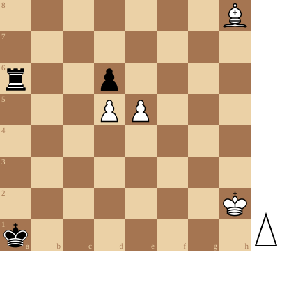

+++
date = '2026-11-24T12:15:49+01:00'
title = 'Diep kijken in de stelling (3)'
weight = 9223372036637097258
+++

<!--
.diagram puzzle.pgn
-->

Deze puzzel is moeilijk. Niets is wat het lijkt.

Nochtans, eens je het juiste plan hebt, komt alles voor elkaar

<!--
.yt RI342yfJa5I
-->


Je kan de video ook bekijken op [dropbox](https://www.dropbox.com/scl/fi/7y9habjhift54xvyajspj/Four_Brilliant_Moves_Here_Can_You_Find_Them_RI34.mp4?rlkey=znrw1z8swjv8o6ew7ummvw9nq&dl=0)<!--
.hidden Klik om het antwoord te zien
-->

Klik om het antwoord te zien

Het juiste plan is "2 vrijpionnen op de 6e rij brengen: de toren is machteloos"
<!--
.puzzle puzzle.pgn
-->

(Je kan de partij <a href="puzzle.pgn">hier</a> downloaden in PGN formaat)

&#160;

<!--
.visible
-->

