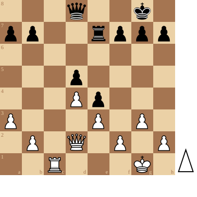

+++
date = '2026-11-16T09:19:29+01:00'
title = 'De beslissende voortzetting'
weight = 9223372036637799038
+++

<!--
.diagram fen:3q2k1/pp2rppp/8/3p4/3Pp3/P3P1P1/1P1Q1P1P/2R3K1 w - - 0 1
-->

In de nationale interclubs kreeg ik met zwart de volgende stelling op het bord.

Mijn tegenstander overzag een sterke voortzetting (maar wist toch te winnen na een lange, moeizame strijd).

Ziet u de juiste voortzetting voor Wit ?

