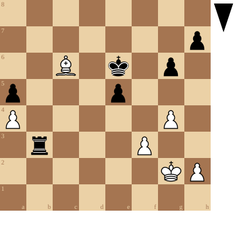

+++
date = '2026-11-16T09:28:55+01:00'
title = 'Marco The Ungrateful met de hakbijl'
weight = 9223372036637798472
+++

<!--
.diagram fen:8/7p/2B1k1p1/p3p3/P5P1/1r3P2/6KP/8 b - - 2 45
-->

In een simultaan-rapid partij op chess.com kwam deze stelling op het bord.

Marco wist, met een paar preciese zetten, de beslissing door te voeren.

Een mooie toepassing van de regel van het vierkant.

Stel een plan op!

