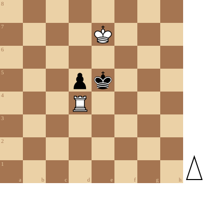

+++
date = '2026-10-14T10:57:27+02:00'
title = 'Toren tegen pion (3)'
weight = 9223372036640647960
+++

<!--
.diagram reti.pgn
-->

De eindspelstudies van [Richárd Réti](https://nl.wikipedia.org/wiki/Rich%C3%A1rd_R%C3%A9ti) zijn legendarisch.

In deze studie neemt een toren het op tegen een pion: een zach eitje zul je zeggen. Kenners weten wel beter: deze eindspelen kunnen buitengewoon moeilijk zijn en vormen de ideale training om diep zicht te krijgen in een positie.

<!--
.yt GWecrPW0wkw
-->


Je kan de video ook bekijken op [dropbox](https://www.dropbox.com/scl/fi/i6stngonmnvyaoixdezsw/Chess_Endgame_Rook_vs_Pawn_Reti_1928_GWecrPW0wkw.mp4?rlkey=adggzxtdr558iq0xbncwon68w&dl=0)
<!--
.game reti.pgn
-->

<!-- Game begin -->
<link href="/okra/js/lichess/pgn/lichess-pgn-viewer.css" type="text/css" rel="stylesheet" />

&#160;

<!-- Game end -->

