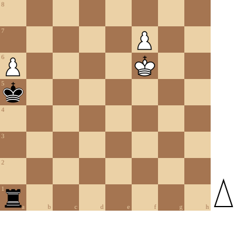

+++
date = '2026-10-27T15:52:48+01:00'
title = 'Toren tegen 2 pionnen'
weight = 9223372036639503439
+++

<!--
.diagram puzzle.pgn
-->

<!--
.yt wXFJSo4zI1k
-->


Je kan de video ook bekijken op [dropbox](https://www.dropbox.com/scl/fi/9n6x9eb7u3n3hdq20qvtz/You_need_to_think_a_while_to_solve_this_one_wXFJ.mp4?rlkey=gwm895ckwvbsyzhq0mbgws21b&dl=0)
<!--
.game puzzle.pgn
-->

<!-- Game begin -->
<link href="/okra/js/lichess/pgn/lichess-pgn-viewer.css" type="text/css" rel="stylesheet" />

&#160;

<!-- Game end -->

