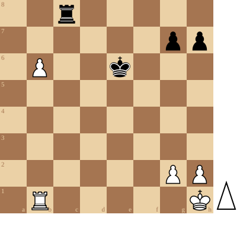

+++
date = '2026-10-27T15:30:33+01:00'
title = 'Torens, pionnen en koningen'
weight = 9223372036639504774
+++

<!--
.diagram puzzle.pgn
-->

<!--
.yt x5-LXTvQK9M
-->


Je kan de video ook bekijken op [dropbox](https://www.dropbox.com/scl/fi/7qq0wfk1sv8bryh7zcyxp/Solve_This_Hard_Chess_Puzzle_x5_LXTvQK9M.mp4?rlkey=fvcq8fu4eafbqmpoy8weocsg8&dl=0)
<!--
.game puzzle.pgn
-->

<!-- Game begin -->
<link href="/okra/js/lichess/pgn/lichess-pgn-viewer.css" type="text/css" rel="stylesheet" />

&#160;

<!-- Game end -->

