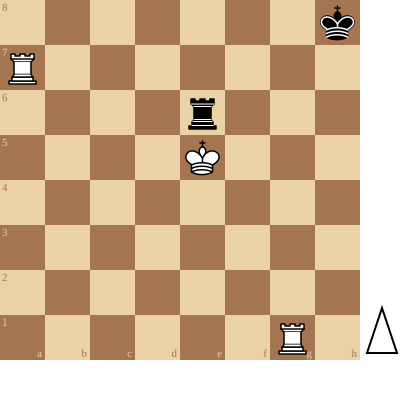

+++
date = '2026-11-04T11:13:30+01:00'
title = 'Schaak geven totdat het pat is ...'
weight = 9223372036638828997
+++

<!--
.diagram puzzle.pgn
-->

Dit is een gekend thema: de toren blijft schaak geven. Indien de koning de toren slaat, is het pat!

Remise lijkt onafwendbaar ... of kan Wit een oplossing vinden ?

<!--
.yt xhhjdEJUa40
-->


Je kan de video ook bekijken op [dropbox](https://www.dropbox.com/scl/fi/k8jq9qr6s5b8qlsn3292x/How_Does_White_Win_This_xhhjdEJUa40.mp4?rlkey=cmn81ux5mey21wcxj1mzrkast&dl=0)
<!--
.game puzzle.pgn
-->

<!-- Game begin -->
<link href="/okra/js/lichess/pgn/lichess-pgn-viewer.css" type="text/css" rel="stylesheet" />

&#160;

<!-- Game end -->

