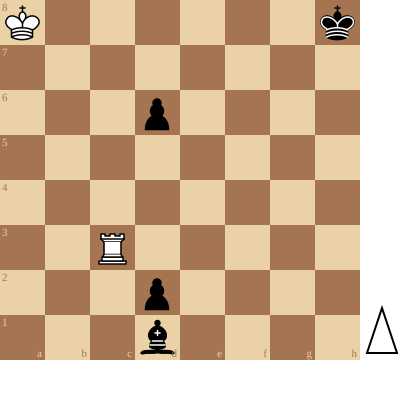

+++
date = '2026-11-10T11:15:50+01:00'
title = 'Diep kijken in de stelling (2)'
weight = 9223372036638310457
+++

<!--
.diagram puzzle.pgn
-->

Het lijkt onmogelijk maar Wit slaagt er in om remise te houden.

Combineer daartoe 2 diepe inzichten in de stelling.

<!--
.yt sN5Phk6mpXA
-->


Je kan de video ook bekijken op [dropbox](https://www.dropbox.com/scl/fi/x1irfbe4fddgieqcl69yn/Don_t_Resign_White_Has_One_Move_sN5Phk6mpXA.mp4?rlkey=5dyd55x8w3zh4y63w4enlpbjp&dl=0)
<!--
.game puzzle.pgn
-->

<!-- Game begin -->
<link href="/okra/js/lichess/pgn/lichess-pgn-viewer.css" type="text/css" rel="stylesheet" />

&#160;

<!-- Game end -->

