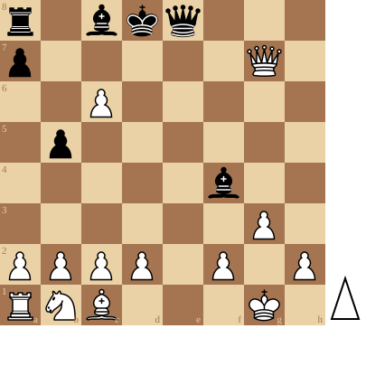

+++
date = '2026-10-16T16:36:30+02:00'
title = 'Puzzel sites'
weight = 9223372036640454817
+++

<!--
.diagram fen:r1bkq3/p5Q1/2P5/1p6/5b2/6P1/PPPP1P1P/RNB3K1 w - - 0 1
-->

Schaakpuzzels oplossen is erg plezierig maar het is ook leerrijk!

Het is een uitstekende methode om je schaakvisie te verbeteren.

Het volgende lijstje bestaat uit een overzicht van uitmuntende websites met grote collecties aan schaakpuzzels. Sommige van deze sites zijn gratis, bij anderen is het voldoende om zich te laten registreren.

Hoe het ook zij, denk steeds aan de opmerking van [Emanuel Lasker (2e wereldkampioen)](https://nl.wikipedia.org/wiki/Emanuel_Lasker)

*"Wenn du einen guten Zug siehst, such nach einem besseren!"*

- https://www.chesspuzzler.com/

- https://www.chessigma.com/puzzles

- https://chesstempo.com/chess-tactics/

- https://www.chess.com/puzzles

- https://lichess.org/training

- https://chesspuzzle.net/List

- https://www.shredderchess.com/online/daily-chess-puzzle.html

